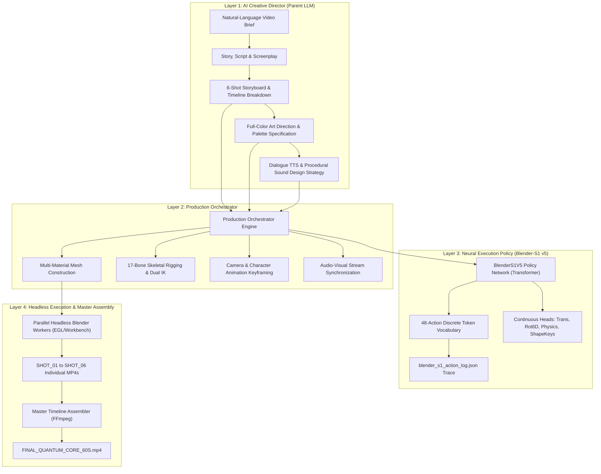

# Blender-S1: Autonomous AI Director & 3D Video Production Engine

## 1. Project Overview & Mission

**Blender-S1** is an autonomous 3D video production system engineered to transform natural-language creative briefs into broadcast-ready, character-driven cinematic short films. 

Rather than relying on 2D video diffusion models with temporal drift, Blender-S1 operates entirely within a deterministic, physically accurate 3D simulation and rendering environment (Blender 5.2.3 LTS). It bridges high-level creative direction with low-level 3D operations through a multi-tiered architecture.

### Primary Production Target:
$$\text{Natural-Language Brief} \longrightarrow \text{Fully Directed, Full-Color 3D Video with Character, Audio \& Subtitles}$$

---

## 2. Four-Layer System Architecture



### Hierarchy Breakdown:
1. **Layer 1 — AI Creative Director (Parent LLM):** Ingests the creative brief, defines narrative pacing, character profiles, multi-camera setups, dialogue lines, sound design requirements, and art direction parameters.
2. **Layer 2 — Production Orchestrator:** Translates creative goals into executable 3D scene graphs, multi-material binding, skeletal armatures, dynamic cloth modifiers, and rendering schedules.
3. **Layer 3 — Neural Execution Policy (`BlenderS1V5`):** A 4-layer Transformer policy checkpoint trained to evaluate 3D spatial state tokens (task, candidate, bone, global) and predict discrete 3D actions across a 48-token vocabulary along with continuous geometric parameters.
4. **Layer 4 — Headless Execution & Master Assembly:** Executes high-speed batch renders (via Blender's Workbench/EEVEE engines), performs automated color QA, and muxes video, dialogue, procedural SFX, ambient scores, and burned subtitles via FFmpeg.

---

## 3. Mandatory Full-Color Production Art Direction Baseline

> [!IMPORTANT]
> **Strict Anti-Grey Mandate:** Any render containing predominantly default grey Blender materials is an automatic failure. Every object, character mesh, and environmental element must be bound to distinct, highly saturated, multi-layered materials.

### Automated Color QA Gate:
- **Saturated Pixel Ratio Threshold:** $\ge 25.0\%$ of pixels must have HSV saturation $S \ge 0.15$.
- **Production Standard Achieved:** $61.1\% - 94.4\%$ across all production shots.

### Color Palette Registry:

| Category | Element | Hex Code | RGB Normalized Tuple | Shader & Physical Properties |
|---|---|---|---|---|
| **Nova (Character)** | Main Suit / Jacket / Pants | `#142238` | `(0.078, 0.133, 0.220)` | Deep Navy, Roughness 0.45 |
| **Nova (Character)** | Plating / Pauldrons / Guards | `#BFC7D5` | `(0.749, 0.780, 0.835)` | Metallic Silver, Metallic 0.92, Rough 0.18 |
| **Nova (Character)** | Circuit Traces & Accents | `#33D6E8` | `(0.200, 0.839, 0.910)` | Electric Cyan, Emission Strength 4.0 |
| **Nova (Character)** | Face & Skin Tone | `#E8B595` | `(0.910, 0.710, 0.580)` | Subsurface-calibrated skin material |
| **Nova (Character)** | Hair Coif | `#1C1620` | `(0.110, 0.080, 0.120)` | Dark Textured, Roughness 0.40 |
| **Nova (Character)** | Dynamic Mantle / Cape | `#9B5CFF` | `(0.608, 0.361, 1.000)` | Silk physics preset, Roughness 0.30 |
| **Quantum Core (Prop)**| Inner Reactor Crystal | `#287BFF` | `(0.157, 0.482, 1.000)` | Luminous Blue, Emission Strength 5.0 |
| **Quantum Core (Prop)**| Outer Energy Shell | `#00D9FF` | `(0.000, 0.851, 1.000)` | Electric Cyan, Emission Strength 6.0 |
| **Quantum Core (Prop)**| Resonant Corona Ring | `#9B5CFF` | `(0.608, 0.361, 1.000)` | Violet Accent, Emission Strength 4.5 |
| **Quantum Core (Prop)**| Gimbal Ring (Inner) | `#00D9FF` | `(0.000, 0.851, 1.000)` | Cyan Conduits, Metallic 0.80 |
| **Quantum Core (Prop)**| Gimbal Ring (Outer) | `#D8DEEB` | `(0.850, 0.870, 0.920)` | Chrome Silver, Metallic 0.95, Rough 0.10 |
| **Lab Architecture** | Floor Grid Tiles | `#141A24` | `(0.078, 0.102, 0.141)` | Dark Metallic Floor, Specular Reflections |
| **Lab Architecture** | Guide Channels | `#33D6E8` | `(0.200, 0.839, 0.910)` | Electric Cyan Floor Lines, Emission 4.0 |
| **Lab Architecture** | Wall Columns & Consoles | `#0D121A` | `(0.050, 0.070, 0.100)` | Charcoal Navy Monoliths, Roughness 0.60 |
| **Status Indicators** | LED Green (Lock/Online) | `#00E676` | `(0.000, 0.900, 0.460)` | Emission Strength 5.0 |
| **Status Indicators** | LED Amber (Warning/Active)| `#FFAB00` | `(1.000, 0.670, 0.000)` | Emission Strength 5.0 |
| **Status Indicators** | LED Red (Alert/Surge) | `#FF1744` | `(1.000, 0.090, 0.270)` | Emission Strength 5.0 |

---

## 4. Character Rigging & Animation Standards

1. **Armature Hierarchy (`Armature_Nova`):**
   - 17 Edit Bones: `Root` $\rightarrow$ `Spine` $\rightarrow$ `Chest` $\rightarrow$ `Neck` $\rightarrow$ `Head`; Shoulders, UpperArms, Forearms, Hands; Thighs, Shins, Feet.
   - Dual 2-Bone Inverse Kinematics (IK):
     - `Shin.L/R` constrained to `Foot_IK.L/R` (chain length 2) for realistic walking locomotion and grounded foot planting.
     - `Forearm.L/R` constrained to `Hand_IK.L/R` (chain length 2) for reaching, console interaction, and defensive bracing.
2. **Deformation:**
   - Multi-material mesh combined into a single unified mesh (`NOVA_Character_Mesh`) deformed via an Armature Modifier with 17 vertex groups.
3. **Facial Blendshapes (Shape Keys):**
   - `Smile`: Expressive mouth curve and cheek lift for resolution scenes (value: 0.0 – 0.85).
   - `Alert_Frown`: Brow lowering and tension for high-stakes moments (value: 0.0 – 0.75).
   - `Blink_L` & `Blink_R`: Natural involuntary eyelid closure cycles (10-frame bell curve).
4. **Dynamic Cloth Physics:**
   - Silk Mantle (`NOVA_Cape`) parented to the Chest bone, pinned at shoulder vertices, reacting to body motion and ambient airflow.

---

## 5. Neural Policy Architecture (`BlenderS1V5`)

The decision-making policy uses a Transformer encoder with specialized projection heads:
- **Model Checkpoint:** `blender_s1_v5_pilot.pt` (SHA-256: `79ac9d5cd20840685b7f6a9a5f0151df98a798cfc57b022d1e95f0b913eca745`).
- **Action Space:** 48 discrete action tokens spanning object creation, transforms, lighting, camera control, rigging, IK setup, pose keyframing, facial shape keys, cloth simulation, and rigid body dynamics.
- **Continuous Prediction Heads:**
  - `trans_head`: 3D position delta $(dx, dy, dz)$.
  - `rot_head`: Continuous 6D rotation representation $(r_1, \dots, r_6)$.
  - `torque_head`: 3D angular impulse.
  - `frame_head`: Target keyframe timing.
  - `physics_head`: Restitution, friction, linear damping, angular damping.
  - `shape_head`: 7 facial/mesh blendshape weights.
  - `constraint_head`: Dynamic constraint influences.
  - `cloth_preset_head`: Cloth physical property presets (Silk, Cotton, Leather, Rubber, Denim).

---

## 6. Sound Design & Multi-Track Synthesis

Every produced short film requires a full audio experience:
1. **Dialogue Synthesis:** Edge-TTS neural models:
   - Narrator: `en-US-GuyNeural` (calm, authoritative documentary tone).
   - Nova: `en-US-AriaNeural` (sharp, focused field scientist tone).
2. **Procedural SFX:** Algorithmic synthesis (48 kHz 16-bit PCM WAV):
   - `SFX_01_REACTOR_HUM.wav`: 55 Hz carrier + 110 Hz overtone + 0.5 Hz frequency drift.
   - `SFX_02_FOOTSTEPS.wav`: Resonant transient impulses for magnetic boots.
   - `SFX_03_INTERFACE_CHIME.wav`: Dual crystal chime at 880 Hz and 1320 Hz with exponential decay.
   - `SFX_04_ENERGY_SURGE.wav`: Resonant frequency sweep (80 Hz $\rightarrow$ 620 Hz) with burst noise.
   - `SFX_05_BARRIER_LOCK.wav`: Electromagnetic impulse and metallic clamping transient.
   - `SFX_06_HARMONIC_OUTRO.wav`: Fifth harmonic chord (220 Hz, 330 Hz, 440 Hz) with gentle release.
3. **Ambient Musical Score:** Continuous 60.0-second ambient cinematic soundtrack with tension and climactic resolution.
4. **Subtitles:** Burned directly into the video stream from `.srt` with high-contrast semi-transparent styling.

---

## 7. Standard Production Runbook

To reproduce or extend a Blender-S1 production:

### Step 1: Initialize Headless EGL & Materials
```python
import bpy

# Set Workbench Material Shading with Cavity for 1.2s/frame performance
scene = bpy.context.scene
scene.render.engine = 'BLENDER_WORKBENCH'
scene.render.resolution_x = 1280
scene.render.resolution_y = 720
scene.render.fps = 24

shading = scene.display.shading
shading.light = 'STUDIO'
shading.color_type = 'MATERIAL'
shading.show_shadows = False
shading.show_cavity = True
shading.cavity_type = 'BOTH'
scene.display.render_aa = 'FXAA'
```

### Step 2: Parallel Batch Rendering
Run concurrent workers across divided frame ranges:
- Worker 1: Shots 1, 2, 3 (720 frames total).
- Worker 2: Shots 4, 5, 6 (720 frames total).

### Step 3: Automated Color QA Gate
```python
from PIL import Image
import numpy as np


def verify_color_qa(image_path):
  img = Image.open(image_path).convert('HSV')
  sat = np.array(img)[:, :, 1] / 255.0
  sat_ratio = float(np.mean(sat >= 0.15))
  return sat_ratio >= 0.25, sat_ratio
```

### Step 4: Final Master Assembly & Subtitle Burn
```bash
ffmpeg -y -f concat -safe 0 -i concat_list.txt -i audio/master_audio_60s.wav \
  -vf "subtitles=FINAL_QUANTUM_CORE_60S.srt:force_style='FontSize=18,PrimaryColour=&H00FFFFFF,OutlineColour=&H00142238,BorderStyle=3,MarginV=30'" \
  -map 0:v:0 -map 1:a:0 \
  -c:v libx264 -pix_fmt yuv420p -preset fast -crf 18 \
  -c:a aac -b:a 192k -shortest \
  FINAL_QUANTUM_CORE_60S.mp4
```

---

## 8. Preserved Historical Checkpoints

The following historical checkpoints must remain permanently preserved and must never be overwritten:
- **Baseline v4.2 Checkpoint:** `blender_s1_v4_2_motion_intelligence.pt`  
  - SHA-256: `1fd7fe174d51b65bbce445465f4394ee95c8339030a8ec00119bd07a19ddb89c`
- **Phase 7 Pilot v5 Checkpoint:** `blender_s1_v5_pilot.pt`  
  - SHA-256: `79ac9d5cd20840685b7f6a9a5f0151df98a798cfc57b022d1e95f0b913eca745`
