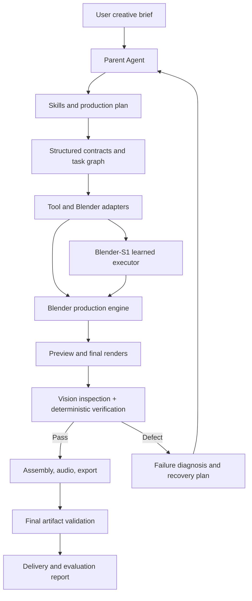

# Blender-S1 — Master Project Skill

> **Purpose:** Give any capable coding, research, or autonomous agent enough project context, operating rules, architectural intent, constraints, evaluation criteria, and roadmap direction to contribute to Blender-S1 without losing the project's history or silently changing its foundations.
>
> **Project owner:** The user who supplied the project context in the originating conversations. Do not infer or invent personal details about the owner.
>
> **Document role:** This is the portable master skill and project-intent document. It is not a substitute for the canonical, detailed Phase 8 architecture specification or the actual source code, schemas, datasets, checkpoints, and benchmark artifacts.

---

## 0. How an agent must use this skill

Read this file before making any Blender-S1 change. Then inspect the actual repository and the canonical architecture documents before acting.

### 0.1 Mandatory first actions

1. Identify the repository root and inspect its top-level structure.
2. Read the repository's `README`, `AGENTS.md`, `CLAUDE.md`, existing skills, architecture documents, and contribution instructions if present.
3. Locate and read the approved Phase 8 specification identified in §2.4. Do not infer its detailed Pydantic schemas from this summary.
4. Inspect the current Git branch, working-tree status, recent commits, tests, model files, checkpoint manifests, data manifests, and benchmark scripts.
5. Map the current implementation to the architecture in this skill. Distinguish implemented code from documentation, prototypes, experiments, and proposals.
6. Reproduce the smallest relevant baseline test before changing behavior whenever feasible.
7. Report material discrepancies between this skill, the canonical Phase 8 specification, repository reality, and newer explicit owner decisions.

**Do not begin by rewriting architecture, retraining a model, changing action IDs, deleting checkpoints, or replacing working components.** First understand what exists.

### 0.2 Use this document as project intent, not as permission to make destructive changes

This skill communicates the target system and operating rules. It does not authorize an agent to:

- overwrite or delete historical checkpoints;
- renumber, repurpose, or silently remove any of the 48 established actions;
- change the approved Phase 8 contract without explicit approval;
- launch expensive or long-running compute jobs without checking current quotas and resource limits;
- upload private project data, credentials, or proprietary assets to an external service without authorization;
- claim an experiment passed without an inspectable result;
- fabricate benchmark results, model capabilities, hardware availability, or product features.

### 0.3 Normative language

- **MUST / MUST NOT:** mandatory project constraint.
- **SHOULD / SHOULD NOT:** strong default; deviations require a technical reason recorded in the work report.
- **MAY:** optional implementation choice.
- **Owner approval:** explicit direction from the project owner, not an agent's inference or a suggestion in an old discussion.

### 0.4 Evidence labels

When reporting status, use these labels:

- **Implemented:** present in the repository and supported by code or tests.
- **Reproduced:** independently rerun with recorded environment, command, inputs, and outputs.
- **Previously reported:** stated in project discussions, but not yet independently reproduced from available artifacts.
- **Proposed:** an intended design or experiment that has not been implemented.
- **Unknown:** insufficient evidence; inspect or ask for the missing artifact.

Never upgrade “previously reported” or “proposed” to “implemented” or “reproduced” without evidence.

---

## 1. Project identity and mission

### 1.1 Project name

**Blender-S1**

### 1.2 Long-term mission

Build an autonomous, AI-directed 3D and cinematic video-production system that can take a natural-language creative brief and carry it through planning, scene construction, animation, rendering, inspection, correction, editing, and final delivery.

The long-term target is **photorealistic cinematic CGI**: realistic human characters, believable environments, physically plausible interactions, coherent animation, professional camera work, consistent lighting and materials, and finished video with audio where requested.

Blender-S1 is not intended to be merely:

- a chatbot that explains Blender;
- a one-shot LLM-to-Python code generator;
- a collection of unrelated Blender scripts;
- a primitive-object animation demo;
- a large language model whose parameter count is treated as the definition of quality.

It is a **hybrid production system** combining language-model reasoning, agent orchestration, specialized skills and tools, a learned execution component, deterministic Blender operations, visual intelligence, verification, and recovery.

### 1.3 The first meaningful product milestone

Produce one genuinely convincing **30–60 second cinematic video** from a natural-language brief using the integrated pipeline. The first acceptance target should normally be 1080p at 24 FPS unless the owner specifies otherwise. 4K is a later production target, not a prerequisite for the first proof of capability.

A successful milestone must be evaluated on the finished visual sequence, not merely on whether Blender scripts ran or frames rendered.

### 1.4 North-star workflow

A user should eventually be able to say something like:

> Create a 60-second cinematic story about a person walking through a realistic futuristic city, meeting another person, talking, and entering a building. Use consistent photorealistic characters, natural movement, realistic environments, professional cinematography, coherent lighting, sound effects, music, and a finished edit.

The system should then:

1. understand the brief and resolve its production requirements;
2. create a screenplay, scene plan, storyboard, and shot list;
3. identify or create the required characters, environments, props, and assets;
4. choose rigs, motion sources, cameras, materials, lighting, and render settings;
5. construct the scenes in Blender;
6. use Blender-S1 for the learned actions and state-dependent execution tasks where it adds value;
7. render previews and final frames;
8. inspect the output using visual and deterministic checks;
9. diagnose and repair defects;
10. assemble video and audio;
11. validate the final file and report what was completed, what remains imperfect, and how it was evaluated.

---

## 2. Project history and known baseline

This section records information discussed by the project owner. An agent MUST verify it against repository artifacts before relying on it as current truth.

### 2.1 Previously reported core foundation

- Blender Python API was installed and used in a Google Colab environment. Project discussions referenced `bpy` / Blender **5.2.3 LTS**; verify the actual environment and version before running work.
- A Blender-S1 project directory structure was established.
- A **State Observer** component and an **Action Executor** component were reported as present.
- The learned execution model was reported at approximately **1.69 million parameters**.
- The established action vocabulary contains **48 actions, IDs 0–47**.
- Historical checkpoints exist and must be preserved.
- A physics and reliability pilot was conducted.
- A separate Phase 3 generalization/reliability evaluation was described as 500 tasks and 1,500 evaluation runs. Detailed result files must be recovered and inspected before quoting aggregate success rates.

### 2.2 Previously reported evaluation numbers

The following metrics appeared in project discussions. Treat all as **previously reported**, not reproduced, until the exact source logs, evaluator version, task definitions, and commands are found and rerun.

| Metric | Previously reported value | Required verification |
|---|---:|---|
| Physical pilot episodes | 48/50 | Recover episode manifest, task set, and logs |
| Physical pilot success | 96% | Confirm numerator, denominator, and success definition |
| Legacy replay retention | 96.4% | Recover replay set and baseline comparison |
| Stacking stability | 100% | Confirm test count and tolerance |
| Velocity handoff continuity | 100% | Confirm test count and measurement |
| Bounce apex error | 4.2% | Recover reference and error formula |
| Stopping-distance error | 4.8% | Recover reference and error formula |
| Cloth penetration | 0.42 mm | Confirm measurement method and sample set |
| Pilot training decisions | 2,500 | Recover dataset/run metadata |
| Larger training target | 40,000 | Treat as a historical target, not achieved status |

Do not present a small pilot as proof of broad real-world generalization. Always report task count, trial count, environment distribution, confidence/variance where possible, and the exact success definition.

### 2.3 Previously reported video experiment

A November 3, 2026 discussion described six generated clips with approximately 60 seconds total duration, 1280×720 resolution, 24 FPS, and 1,440 total frames. The clips were described as predominantly grey primitive geometry (cubes, spheres, and cylinders), with no audio and without demonstrated photorealistic characters, detailed environments, expressive acting, or finished cinematic assembly.

Interpretation:

- The experiment demonstrated a working render/video pipeline at a basic level.
- It did **not** demonstrate production-quality cinematic generation.
- A rendered frame count is not a visual-quality metric.
- The exact videos and render logs should be located and reviewed before making detailed claims about them.

### 2.4 Canonical Phase 8 specification — highest-priority project reference

The project owner identified the following canonical document:

- **Document ID:** `BLENDER-S1-P8-ARCH-001`
- **Version:** `1.0.0`
- **Date:** `2026-11-03`
- **Status:** Approved Specification & Execution Contract

Recorded intent of that specification:

- preserve Blender-S1 Actions **0–47**;
- preserve historical checkpoints;
- do not retrain the existing model merely to add the Parent LLM integration;
- integrate a provider-independent Parent LLM using structured Pydantic outputs;
- preserve compatibility with the existing execution system.

**Mandatory rule:** The actual Phase 8 document is authoritative for the detailed architecture, schemas, names, field constraints, data flow, and execution contract. This skill only records its known intent. An agent MUST locate and read the real document before implementing or modifying Phase 8 behavior. Do not invent Pydantic models, field names, action semantics, or API contracts and claim they are canonical.

If the document is not present in the repository or supplied materials, report that blocker and continue only with non-invasive discovery or work that is clearly independent of the missing contract.

### 2.5 Known project context that is not the Blender-S1 source of truth

The owner has also discussed browser agents, YOLO UI perception, MCP infrastructure, and other projects. Those should not be imported into Blender-S1 unless the repository or owner explicitly establishes a dependency. Do not conflate unrelated benchmark results or codebases with Blender-S1.

---

## 3. Design principles

Every implementation decision should follow these principles.

1. **Preserve proven work.** Protect the baseline model, 48-action vocabulary, historical checkpoints, and approved Phase 8 contract.
2. **Inspect before changing.** Repository reality outranks assumptions from memory or a summary.
3. **Separate intelligence from execution.** The Parent Agent plans and orchestrates; the learned model performs its defined learned execution role; Blender and tools perform deterministic operations.
4. **Use structured contracts.** Agent-to-tool communication must be typed, validated, versioned, and observable.
5. **Remain provider-independent.** Do not hardwire the entire product to one Gemini model, IDE, SDK, or vendor-specific runtime.
6. **Prefer deterministic tools for deterministic tasks.** Use Blender Python, explicit scene data, physics settings, file checks, and numeric validation where possible.
7. **Close the visual feedback loop.** Inspect rendered output and correct measurable defects; do not stop at script success.
8. **Measure before scaling.** Bigger models, more agents, more GPU hours, and more complex prompts are not improvements unless a benchmark proves value.
9. **Separate training from production.** Experiments must not mutate production checkpoints or silently change the runtime contract.
10. **Make work reproducible.** Record code revision, environment, model version, dataset version, seeds, configuration, commands, logs, and output artifacts.
11. **Respect compute limits.** Place workloads on the least costly suitable environment and verify actual hardware rather than assuming a GPU type or quota.
12. **Respect asset rights and privacy.** Track licenses and provenance; do not upload confidential data without authorization.
13. **Be honest about quality.** A VLM score, render completion, or agent self-report is not by itself proof of photorealism or production readiness.
14. **Optimize the finished video.** The final user-visible result is the north-star product metric.

---

## 4. System architecture and responsibility boundaries

### 4.1 Logical components

The intended system contains the following cooperating components. Their exact implementation can evolve, but interfaces and responsibilities must remain explicit.

| Component | Primary responsibility | Must not become |
|---|---|---|
| User/Creative Brief Interface | Capture intent, constraints, output target, references, and acceptance criteria | An unvalidated prompt passed directly to code execution |
| Parent Agent / Parent LLM | Interpret intent, plan work, select skills/tools, coordinate tasks, decide next steps | An unrestricted authority that bypasses contracts and safety checks |
| Agent Harness | Instructions, skills, tool adapters, context management, subagents, session handling, observability | A hard dependency on one interactive IDE session for production runtime |
| Skill Library | Reusable domain instructions, workflows, examples, validation rules | Unversioned prompts with hidden assumptions |
| Persistent Project/Creative Memory | Durable project state, character bibles, scene continuity, decisions, and learning records | IDE chat history as the only memory |
| Vision-Language Model (VLM) | Understand images/frames, identify semantic visual defects, answer visual questions | A substitute for deterministic checks or actual scene-editing tools |
| Blender-S1 Learned Executor | Existing learned action policy and supported state-dependent execution | A general-purpose story LLM or an assumed replacement for all Blender APIs |
| Blender Production Engine | Modeling, asset loading, rigging, animation, simulation, materials, cameras, lighting, rendering, compositing, editing | An assumed capability that appears automatically from a larger LLM |
| Verification Engine | Validate state, action results, scene properties, render artifacts, temporal continuity, and output files | A subjective “looks good” statement without evidence |
| Recovery Engine | Classify failures, select safe repairs, retry bounded operations, record learning | Infinite retries or uncontrolled scene mutations |
| Compute Scheduler | Choose local, Colab, Kaggle, or cloud resources based on workload | Assumption that multiple GPUs pool their VRAM |

### 4.2 High-level data flow



### 4.3 Parent Agent responsibilities

The Parent Agent SHOULD:

- translate a creative brief into explicit requirements and acceptance criteria;
- maintain a scene graph, character bible, asset list, shot list, task graph, and production state;
- select and invoke skills based on task type;
- delegate independent tasks only when dependencies and merge boundaries are explicit;
- call tools through validated interfaces;
- ask for clarification only when a missing fact materially changes the output or causes unsafe/irreversible work; otherwise make documented, reversible creative defaults;
- monitor execution and verify outputs;
- choose correction steps based on evidence;
- maintain a traceable record of decisions.

The Parent Agent MUST NOT:

- assume the IDE's interactive agent session is a production-callable endpoint;
- invent successful tool results;
- change frozen actions or checkpoints without approval;
- allow untrusted model output to execute as arbitrary Python without validation and sandboxing;
- claim a generated video is photorealistic merely because it rendered;
- keep retrying indefinitely or consume a compute quota without a budget/stop condition.

### 4.4 Blender-S1 executor responsibilities

The learned component's current known role is specialized action/execution intelligence using the established 48-action vocabulary. An agent must inspect its actual observation representation, policy, model architecture, action semantics, training procedure, and state interface before extending it.

Do not assume the current learned model:

- creates production-quality human assets;
- understands natural-language stories by itself;
- directly produces video pixels;
- replaces Blender's full Python API;
- has demonstrated long-horizon cinematic competence.

The learned component should be used where empirical results show it adds value over deterministic Blender tools or an explicit Parent-Agent plan.

### 4.5 Blender Production Engine responsibilities

Use Blender's supported Python API and deterministic tools for operations such as:

- scene creation and scene graph management;
- importing and instantiating assets;
- object transforms and constraints;
- materials and shader configuration;
- cameras, lenses, depth of field, lights, and world settings;
- rigging and animation data application;
- physics and simulation configuration;
- render configuration and output management;
- compositing and video assembly where appropriate.

Prefer reusable, tested Blender scripts and data-driven scene specifications over huge one-off scripts generated from free-form prompts.

---

## 5. Parent LLM, Antigravity, and agent harness strategy

### 5.1 Strategic intent

The owner is interested in using Gemini through the Antigravity development environment because the harness can provide more than a plain model call: project instructions, skills, tools/MCP integrations, terminal and filesystem operations, context handling, agent delegation, and iterative workflows.

This is a valuable **development and orchestration strategy**, but the distinction between IDE agent and runtime agent is mandatory.

### 5.2 Two separate roles

**A. Development agent (Antigravity IDE):**

- understand and modify the repository;
- create or improve Blender-S1 code and skills;
- run tests, scripts, and experiments;
- inspect render outputs and logs;
- develop the runtime agent architecture;
- prepare reproducible changes and reports.

**B. Production Parent Agent (runtime):**

- receive a creative brief from the Blender-S1 application;
- maintain a production task/session state;
- call approved skills and tools;
- return structured plans and tool requests;
- coordinate Blender execution and visual feedback.

An interactive IDE agent is not automatically embeddable as a service. If the owner chooses a managed agent SDK, API, or another runtime, implement it behind the provider-independent Parent Agent interface.

### 5.3 Provider-independent adapter

The runtime should expose an internal interface that hides provider-specific APIs. Its responsibilities should include:

- provider/model selection;
- prompt and skill assembly;
- structured output validation;
- tool-call translation;
- retry and timeout handling;
- session/context identifiers;
- token/cost/usage telemetry where available;
- error normalization;
- policy and authorization checks.

Use the canonical Phase 8 Pydantic contracts. Do not create a competing schema. If the canonical schema is unavailable, stop before defining a replacement and request the authoritative specification.

### 5.4 Skills as progressive expertise

Skills should be modular and loaded only when relevant. The Parent Agent should not receive every detailed production instruction for every request. Keep the core orchestration instructions compact and delegate specialized workflows to skill documents.

### 5.5 Context and memory

Use durable stores for production memory. Session transcripts may help debugging but are not the source of truth.

Persist at least:

- project and architecture version;
- production/job ID;
- current brief and acceptance criteria;
- scene/shot graph;
- character and environment identities;
- asset IDs, provenance, and licenses;
- approved creative decisions;
- action/task history;
- render versions and hashes;
- verification results;
- unresolved defects;
- retry/recovery history.

Use explicit retention, versioning, and privacy policies. Avoid storing secrets or personal data that are not needed for production.

---

## 6. Recommended skill library

The following is the proposed initial library. These are **recommended skills**, not claims that they already exist. An agent should inspect the repository before creating duplicates.

| Skill | Purpose | Typical outputs |
|---|---|---|
| `story-director` | Understand the brief, genre, tone, audience, stakes, and story beats | Story synopsis, screenplay outline, character goals |
| `production-planner` | Convert the brief into a feasible production plan | Task graph, schedule, resource plan, acceptance criteria |
| `scene-planner` | Divide story into scenes and shots | Scene list, shot list, durations, transitions |
| `character-bible` | Define consistent characters and identity constraints | Character specs, reference views, asset identity IDs |
| `human-asset-pipeline` | Find/create/prepare human models and assets | Model, rig, textures, provenance record |
| `environment-builder` | Construct realistic locations and sets | Environment specification, asset manifest, scene script |
| `prop-and-asset-manager` | Track objects, materials, versions, licensing, and dependencies | Asset registry and validation report |
| `character-rigging` | Prepare skeletons, controls, skinning, and facial rigs | Rig validation and control map |
| `character-animation` | Apply motion capture, animation clips, procedural motion, and facial acting | Animation actions and timing curves |
| `physics-orchestration` | Coordinate physics tasks with Blender-S1 where appropriate | Validated action plan and simulation checks |
| `camera-cinematography` | Plan lenses, framing, camera movement, and shot grammar | Camera rigs and shot specifications |
| `lighting-and-materials` | Configure physically based materials and lighting | Shader/light setups and exposure checks |
| `render-optimization` | Select renderer, quality, samples, denoising, and resource strategy | Render profile and cost/time estimate |
| `visual-quality-control` | Inspect rendered frames and identify visual defects | Defect report with frame/time references |
| `continuity-manager` | Preserve character, prop, environment, and lighting continuity | Continuity bible and mismatch report |
| `audio-production` | Plan dialogue, sound, ambience, music, and mix | Audio asset plan and timeline |
| `editing-and-compositing` | Assemble shots, transitions, effects, titles, and final export | Edit decision list and final project |
| `recovery-engine` | Diagnose failed tools, simulations, renders, and visual defects | Bounded recovery plan and regression test |
| `benchmark-manager` | Run fixed evaluations and compare versions | Machine-readable results and summary |
| `compute-scheduler` | Choose local/Colab/Kaggle/cloud resources | Placement decision and resource manifest |

### 6.1 Required structure for an individual skill

Use a standard, portable folder format unless the host agent platform requires a different one:

```text
skills/
  <skill-name>/
    SKILL.md
    references/       # Optional, versioned reference material
    scripts/          # Optional, tested helper scripts
    examples/         # Optional, grounded examples
    tests/            # Optional, validation tests
```

Each skill should include:

1. name and description;
2. when to use it and when not to use it;
3. required inputs and assumptions;
4. step-by-step workflow;
5. tools and interfaces it may call;
6. output format/contracts;
7. validation and acceptance criteria;
8. failure modes and recovery;
9. examples grounded in the repository;
10. version and dependencies.

A skill must not redefine global action semantics or Phase 8 schemas.

---

## 7. Persistent project, creative, and execution memory

Use four logical memory domains. They may live in one database or several stores, but their ownership and schemas must be explicit.

### 7.1 Project memory

Store architecture decisions, specs, tool contracts, action definitions, model versions, migrations, build/test procedures, and accepted constraints.

### 7.2 Creative memory

Store reusable character bibles, environment descriptions, approved visual references, story facts, style guides, shot continuity, and recurring production decisions.

### 7.3 Execution memory

Store action/task trajectories, successful and failed execution patterns, state transitions, recovery outcomes, simulation settings, and relevant benchmark observations.

### 7.4 Quality memory

Store render versions, frame samples, detected defects, human review feedback, visual evaluation outcomes, correction history, and quality-gate decisions.

### 7.5 Memory rules

- Store facts with provenance, timestamps, version, and confidence/status.
- Distinguish owner-approved decisions from agent suggestions.
- Do not treat an unverified VLM judgment as ground truth.
- Do not silently overwrite older records; version material decisions.
- Avoid duplicate or contradictory memory records.
- Keep large binary assets in artifact/object storage and reference them by stable IDs/locations.
- Make memory searchable and exportable so it is not locked to a specific IDE or model provider.

---

## 8. Photorealistic production requirements

### 8.1 Photorealism is a pipeline outcome

Blender can produce photorealistic CGI, but a render engine or GPU alone does not create realistic people and environments. Quality depends on asset quality, anatomy, grooming, textures, shaders, lighting, motion, cameras, composition, rendering, and post-production.

Do not claim that installing Blender, using Cycles, or increasing VRAM automatically produces Hollywood-level results.

### 8.2 Human-character pipeline

A production-ready human workflow may require:

- high-quality base mesh and correct anatomy;
- clean topology and appropriate subdivision;
- realistic skin textures and physically based shading;
- subsurface scattering configured appropriately;
- eyes, teeth, brows, lashes, and detailed facial features;
- hair grooming or high-quality hair assets;
- clothing, fabric, and accessory assets;
- body rigging and deformation quality;
- facial rig/blendshape system;
- motion capture or authored animation;
- retargeting and contact correction;
- believable facial acting and lip synchronization when dialogue is used;
- continuity validation across camera angles and lighting.

Use appropriate licensed or owner-created assets. Track model, texture, motion, and voice rights. Do not assume a model found online is free for commercial use.

### 8.3 Environment pipeline

A convincing environment may require:

- reference and layout planning;
- scale and spatial consistency;
- architecture and prop assets;
- terrain, vegetation, roads, furniture, and set dressing;
- high-resolution textures and UV quality;
- physically based materials;
- realistic world illumination and practical lights;
- atmospheric effects where appropriate;
- camera-aware level of detail and visibility management;
- asset instancing and memory optimization.

### 8.4 Animation pipeline

Photorealistic animation requires temporal plausibility, not only attractive still frames. Validate:

- foot contact and foot sliding;
- weight transfer and balance;
- joint limits and deformation;
- collisions and object interaction;
- hand contact and grasping;
- facial expressions and gaze;
- lip sync when needed;
- motion transitions and acceleration;
- temporal consistency and identity stability;
- camera movement and scene continuity.

Use motion capture, licensed animation libraries, procedural animation, keyframing, or a hybrid approach as appropriate. Blender-S1 should not be forced to learn all animation data from scratch when established tools and assets are more reliable.

### 8.5 Cinematography and post-production

Plan shots intentionally. Record camera, lens, focal length, framing, movement, focus, exposure, lighting, and shot duration. Maintain a coherent visual grammar across a sequence.

The final pipeline may include compositing, color management, color grading, transitions, titles, dialogue, ambience, music, sound effects, loudness/mix checks, subtitles, and encoding. Audio is an explicit production track; it is not automatically supplied by Blender's 3D render.

### 8.6 Asset strategy

A hybrid asset strategy is preferred:

- use procedural generation for repeatable structures and suitable environments;
- use high-quality existing assets for humans, clothing, vehicles, foliage, props, and motion when licensing allows;
- use artist-authored assets where quality or uniqueness requires it;
- use image/video/3D generation tools only when available, authorized, and quality-tested;
- maintain a searchable asset registry with provenance, license, version, dependencies, and technical requirements.

Never imply that a text-to-video model, image generator, or external service is already integrated unless the repository proves it.

---

## 9. Vision intelligence and visual verification

### 9.1 Purpose

The VLM should provide semantic understanding of rendered frames and help identify visual defects. It is a perception/evaluation component, not the sole judge of production correctness.

Candidate models discussed include Gemini vision, Qwen-VL variants, InternVL, and SmolVLM/SmolVLM2. These are candidates for controlled testing, not approved production selections.

### 9.2 Evaluation tasks

Evaluate a vision model on Blender-specific examples:

- object/character identification;
- scene and environment description;
- spatial relation understanding;
- composition and framing;
- lighting and material defects;
- visible geometry and clipping errors;
- character anatomy and deformation issues;
- character identity consistency across frames;
- temporal changes and continuity;
- storyboard-to-render semantic matching;
- OCR/text readability only where relevant.

### 9.3 VLM evaluation protocol

1. Build a versioned set of representative frames and short sequences.
2. Define defect labels and reference answers with human review.
3. Include easy, difficult, and adversarial examples.
4. Compare model outputs against human-reviewed labels.
5. Measure false positives and false negatives, not just overall accuracy.
6. Record model version, prompt, resolution, preprocessing, latency, memory, and cost.
7. Test whether detected defects can actually be corrected by available tools.
8. Select the simplest model that achieves the needed task-specific performance.

Do not choose a VLM based only on a general benchmark or parameter count.

### 9.4 Deterministic verification

Use code for facts that code can verify:

- expected objects exist;
- object transforms fall within tolerances;
- required materials, cameras, lights, and rigs are present;
- animation frame ranges are valid;
- physics constraints and contacts meet thresholds;
- rendered frame count and dimensions are correct;
- output files are nonempty and decodable;
- audio/video durations match expected timelines;
- render jobs and output manifests are complete.

Use human or VLM review for subjective and semantic properties, while clearly labelling their confidence and limitations.

### 9.5 Closed-loop correction

The intended loop is:

1. render a preview or sample frames;
2. run deterministic validation;
3. run VLM inspection where useful;
4. combine evidence into a defect list;
5. classify each defect by likely cause;
6. ask the Parent Agent to plan a bounded correction;
7. apply a minimal, reversible change;
8. rerender affected frames or shots;
9. verify that the defect improved and no regression was introduced;
10. record the correction and its outcome.

Use retry limits, compute budgets, and explicit stop conditions. Do not loop endlessly.

---

## 10. Blender-S1 learned model: scaling and training

### 10.1 Baseline protection

The existing approximately 1.69M-parameter model is the baseline. Preserve its source, checkpoint, configuration, action mapping, preprocessing, and evaluation artifacts.

The historical checkpoint must remain immutable. Create new experiment directories or artifact versions for candidate models.

### 10.2 Candidate model sizes

The owner discussed exploring the following sizes:

| Variant | Approximate target size | Status |
|---|---:|---|
| S1 baseline | 1.69M parameters | Existing baseline; reproduce |
| S1-L | 5M parameters | Proposed experiment |
| S1-XL | 10M parameters | Proposed experiment |
| S1-XXL | 20M parameters | Proposed experiment |

These are experimental targets only. Do not assume that a larger model improves performance. Architecture, observations, data quantity/quality, training objective, optimization, and generalization all matter.

### 10.3 Preserve the 48-action contract initially

For the first scaling experiments:

- keep action IDs 0–47 unchanged;
- keep their semantic meanings unchanged;
- keep observation and output contracts compatible;
- do not remove or repurpose actions;
- compare candidates on identical evaluation tasks;
- preserve a compatibility adapter where needed.

Any future new action must have a documented rationale, owner approval, a versioned action schema, explicit migration/compatibility strategy, tests, and a regression benchmark. Never silently modify an existing ID.

### 10.4 Training data strategy

Before increasing model size, inspect the current data pipeline and determine whether the limiting factor is model capacity, data coverage, label quality, observation design, reward/target design, or environment distribution.

Dataset work should include:

- immutable raw data and versioned derived data;
- trajectory/task identifiers;
- environment and scene configuration;
- observation and action schema version;
- success/failure labels and objective measurements;
- source/provenance and generation script;
- train/validation/test split by task, scene, or configuration to reduce leakage;
- difficult and failure examples;
- balanced coverage of action classes and edge conditions;
- deterministic preprocessing where possible;
- data-quality tests and duplicate detection.

Do not use the same near-duplicate episode or scene across train and test splits and then claim generalization.

### 10.5 Training experiment procedure

For every candidate:

1. record the baseline and hypothesis;
2. freeze the dataset version and split;
3. record architecture and parameter count;
4. record optimizer, learning-rate schedule, loss, batch size, precision, seeds, epochs/steps, and early-stopping rule;
5. record environment and hardware;
6. train with checkpointing and resumability;
7. evaluate on the fixed validation and test suites;
8. compare execution success, generalization, calibration, inference latency, memory, and stability;
9. run regression tests against the 48-action contract;
10. retain the candidate only if its improvement is measurable and worth its cost.

Do not tune on the final test set. Keep a held-out test suite for promotion decisions.

### 10.6 Training promotion gate

A candidate model may be promoted only when:

- the baseline has been reproduced;
- the same test tasks and success definitions are used;
- no existing action has regressed beyond an approved tolerance;
- broad generalization is evaluated, not just training accuracy;
- inference resource requirements are acceptable;
- checkpoint and configuration are reproducible;
- the owner-approved Phase 8 interface remains compatible;
- results and artifacts are archived.

---

## 11. Compute and infrastructure strategy

The project enforces a **Zero-Local Execution Mandate**: the project owner's development laptop runs strictly the Antigravity Agent Control Room. **Zero local Blender processes, zero local Cycles rendering, and zero local PyTorch execution run on the laptop.** All 3D modeling, rigging, simulation, animation, and rendering execute remotely on cloud accelerators (Google Colab and Kaggle), with all persistent state, assets, models, and outputs saved directly to Google Drive.

### 11.1 Resource allocation policy

| Environment | Preferred use | Avoid by default |
|---|---|---|
| Local laptop | **Agent Control Room ONLY (Antigravity IDE)**: Prompt editing, Pydantic schemas, Git versioning, workflow dispatching | **Zero local Blender execution, zero rendering, zero heavy PyTorch** |
| Google Drive SAN | **Persistent Cloud Studio Storage (`<DRIVE_MOUNT>/blender_s1/`)**: Models, MPFB2 assets, Poly Haven PBR textures, BVH clips, .blend scenes, outputs | Relying on ephemeral `/content/` disk in Colab |
| Google Colab | **Primary Remote Production Engine (via `colab-mcp`)**: Headless Blender 5.2.3 LTS, MPFB2 character generation, Rigify rigging, BVH motion, EEVEE/Cycles draft previews | Long unattended batch renders exceeding session limits |
| Kaggle notebooks | **High-Value Parallel Batch Cluster**: Dual NVIDIA T4 (15.3 GB + 15.3 GB) parallel Cycles frame rendering (GPU 0 & GPU 1 split), large VLM validation | Assuming a combined 32GB VRAM pool for monolithic models |
| Dedicated cloud GPU | Time-sensitive production or scenes with measured VRAM exceeding 16GB | Unmonitored instances without hard budget shutdown rules |
| Future workstation | Local production after measured benchmarks on 30s film prove real local bottleneck | Premature hardware purchase before pipeline completion |

### 11.2 Google Drive Cloud Studio SAN Policy

Google Drive is the authoritative persistent storage layer for the studio:
- **Mount Path in Colab:** `<DRIVE_MOUNT>/blender_s1/`
- **Mandatory Subdirectories:**
  - `checkpoints/`: Preserved neural policy checkpoints (`blender_s1_v3` through `v5_pilot.pt`).
  - `assets/characters/`: MPFB2 humanoid meshes, facial edge loops, Rigify rigs.
  - `assets/materials/`: Poly Haven CC0 PBR texture sets (Albedo, Roughness, Normal, Metallic) and 2K/4K HDRIs.
  - `assets/props/`: Quantum Core energy prop and laboratory geometry.
  - `assets/motion/`: Curated BVH locomotion and gesture motion clips.
  - `productions/`: Production scenes (`.blend`), raw frame sequences (`PNG`), and master encoded videos (`.mp4`).
  - `logs/`: Pydantic manifests, execution traces, and VLM quality scorecards.
- **Persistence Guarantee:** Google Drive eliminates Colab's 12-hour reset penalty. Any asset, scene, or rendered frame written to Drive persists across sessions and is reusable across all future productions.

### 11.3 Colab policy (Remote Execution Engine)

Colab is the remote execution environment for headless Blender 5.2.3 LTS and routine policy experiments, connected to Antigravity via `colab-mcp` (`open_colab_browser_connection`) and the minimal 7-call TCP socket bridge.

Before a run, record:
- actual GPU model and count;
- available GPU memory;
- system RAM;
- CPU details;
- runtime and package versions;
- storage location and remaining capacity;
- session limitations and estimated run duration.

Use resumable rendering, periodic frame checkpoints, logs, and Google Drive persistent storage. Do not assume a T4 is always available or that session limits are fixed.

For relatively small structured-input policy models (the discussed 1.69M–20M range), a 16GB T4 is expected to be ample in many conventional training setups, but confirm using a representative batch and peak-memory measurement. High-resolution vision/video inputs change the memory profile substantially.

### 11.4 Kaggle policy

Preserve Kaggle's free GPU quota for experiments that benefit materially from its accelerator capacity.

Prioritize:

- VLM evaluation and inference;
- large-scale image/feature processing;
- photorealistic rendering experiments;
- parallel rendering of independent frames or shots;
- larger visual validation jobs;
- GPU-heavy research that is impractical on the current Colab allocation.

Verify the actual accelerator type, count, memory, availability, runtime quota, and session limits at the beginning of each notebook. Do not hardcode an assumed T4 x2 environment.

**Multi-GPU memory rule:** Two 16GB GPUs provide two independent 16GB memory spaces; they do not automatically create a single 32GB VRAM pool. Data-parallel jobs may replicate the model/scene on each GPU. Frame-level rendering can distribute independent frames when each GPU can fit the scene. Model- or scene-parallel memory sharing requires explicit supported implementation.

### 11.4 CPU versus GPU for Blender simulations

Do not assume Blender physics simulation accelerates on the GPU merely because a GPU is present. Benchmark CPU and GPU behavior for the specific Blender feature, version, and scene. Many simulation and dependency-graph operations are CPU-bound or have limited GPU acceleration.

### 11.5 Future workstation budget

The owner discussed an eventual workstation budget of **₹1–2 lakh INR**, but no purchase decision has been made.

Previously discussed options included:

- an NVIDIA workstation with a newer GPU such as an RTX 5070-class card;
- a carefully inspected used RTX 3090 with 24GB VRAM;
- Apple Silicon systems with unified memory;
- cloud rendering instead of owning hardware.

These are comparison candidates, not a fixed bill of materials. Prices and product generations change. Do not repeat historical prices as current quotes. Before recommending a purchase, verify current Indian pricing, warranty, availability, power/cooling compatibility, and actual Blender benchmark results.

A 24GB or 32GB dedicated-VRAM GPU may be useful for large Cycles scenes, but scene requirements must be measured. Apple unified memory can hold large working sets, but CPU, GPU, and OS share that pool; unified memory must not be described as equivalent to dedicated VRAM. Compare Apple Metal and NVIDIA CUDA/OptiX using the same Blender version, same scene, same render settings, and repeated runs.

### 11.6 Render compute strategy

- Use low-resolution, low-sample previews during iteration.
- Render representative frames before committing to a long animation.
- Estimate cost/time from measured frames per second or seconds per frame.
- Separate scene construction, simulation baking, final rendering, compositing, and encoding.
- Use per-frame or per-shot distribution only when scene dependencies are safe.
- Check whether scene assets and caches fit on each device.
- Apply denoising and adaptive sampling carefully; compare image quality.
- Save render manifests and file hashes.
- Shut down cloud resources when jobs finish or hit stop conditions.

---

## 12. Benchmarks, evaluation, and quality gates

A unified benchmark suite is required. Do not report one aggregate “Blender-S1 accuracy” as if it captures every capability.

### 12.1 Evaluation levels

**Level 0 — Infrastructure and reproducibility**

- environment installation;
- deterministic test setup;
- file and checkpoint integrity;
- memory, latency, and crash behavior;
- ability to rerun the same experiment.

**Level 1 — Learned action execution**

- per-action accuracy;
- action completion rate;
- state-transition correctness;
- action latency;
- invalid-action frequency;
- recovery rate;
- backward compatibility with action IDs 0–47.

**Level 2 — Physical and scene tasks**

- object placement and alignment;
- collision and contact correctness;
- trajectory/velocity errors;
- stability and constraint satisfaction;
- task completion across unseen configurations.

**Level 3 — Scene construction**

- required asset presence;
- object and camera transforms;
- materials, textures, and light setup;
- scene organization;
- geometry/mesh validity;
- asset and license provenance.

**Level 4 — Character and animation**

- anatomy and deformation;
- facial and body rig quality;
- foot sliding and contact;
- motion smoothness;
- identity consistency;
- facial acting and lip sync where applicable;
- collision and object interaction.

**Level 5 — Cinematic sequence**

- shot composition and continuity;
- lighting consistency;
- visual realism;
- temporal stability;
- story/brief coverage;
- transitions and pacing;
- audio and final assembly.

### 12.2 Core metrics

Track appropriate subsets of:

- task success rate and confidence interval;
- per-action confusion matrix;
- invalid actions and execution failures;
- recovery success and retries per task;
- physics error metrics with units and definitions;
- generalization gap across held-out environments;
- model parameter count and inference latency;
- peak GPU VRAM and system RAM;
- render time per frame and total production time;
- output resolution, frame rate, frame count, and duration;
- failed/missing/corrupt frames;
- objective continuity checks;
- human-reviewed visual ratings and defect counts;
- VLM false-positive/false-negative rates against human labels;
- cost per rendered minute where cloud costs apply.

No single image metric or VLM score proves photorealism. Use a combination of technical checks, side-by-side comparisons, human review, and task-specific metrics.

### 12.3 Visual quality rubric

For each sampled shot, assess at least:

1. **Subject fidelity:** anatomy, face, eyes, skin, hair, clothing, and object shape.
2. **Material realism:** texture scale, roughness, reflections, subsurface behavior, and surface detail.
3. **Lighting:** plausible sources, contact shadows, exposure, bounce, and consistency.
4. **Environment:** scale, detail, perspective, asset quality, and composition.
5. **Motion:** natural dynamics, contacts, deformations, and temporal smoothness.
6. **Camera:** lens, framing, focus, movement, and shot coherence.
7. **Continuity:** identity, costume, props, environment, and lighting across frames/shots.
8. **Story alignment:** whether the output actually communicates the requested action and narrative.

Score with a documented rubric and retain sampled frames. Report subjective ratings as subjective.

### 12.4 Quality gates

A production task should not be called complete until:

- all required shots exist;
- all expected frames are present and decodable;
- dimensions, frame rate, and duration are correct;
- audio requirements are met or explicitly marked not requested;
- required assets and scene dependencies are resolved;
- deterministic checks pass;
- high-severity visual defects are resolved or disclosed;
- character/environment continuity is checked;
- output is assembled and playable;
- the final report includes known limitations.

---

## 13. Failure taxonomy and recovery policy

Classify failures before attempting a fix.

| Failure class | Examples | Typical response |
|---|---|---|
| Brief/requirement failure | Ambiguous request, missing target duration | Clarify or document a reversible assumption |
| Planning failure | Missing shot, impossible schedule | Re-plan task graph and dependencies |
| Asset failure | Missing model, broken texture, license issue | Resolve asset, use an approved fallback, update manifest |
| Scene-construction failure | Invalid transform, broken modifier, missing object | Validate and apply minimal script correction |
| Rig/animation failure | Bad deformation, foot sliding, no contact | Adjust rig/motion/retargeting and rerun tests |
| Physics failure | Instability, collision penetration | Inspect units, timestep, solver, constraints, and scene scale |
| Render failure | GPU OOM, device error, corrupt frame | Reduce preview settings, split work, optimize scene, retry within budget |
| Visual-quality failure | Plastic skin, bad lighting, artifacts | Identify root cause and fix assets/materials/lighting, not merely prompt wording |
| Continuity failure | Character/clothing/prop changes | Use persistent IDs, shared assets, and continuity checks |
| Audio/edit failure | Missing track, desynchronization | Validate timeline and media metadata, reassemble |
| Agent/tool failure | Timeout, invalid schema, tool error | Normalize error, retry safely, preserve trace |
| Model failure | Wrong action, poor generalization | Capture trajectory, classify data gap, evaluate candidate training change |

### Recovery rules

- Retry transient failures only with bounded backoff and a maximum attempt count.
- Do not retry deterministic schema/validation errors without changing the cause.
- Preserve artifacts from failed runs for diagnosis where safe.
- Make changes reversible and as small as practical.
- Rerun the narrowest relevant test, then broader regression tests.
- Record root cause, fix, and whether the fix generalizes.
- Never allow a recovery agent to rewrite the action contract or checkpoints automatically.

---

## 14. Development and repository operating rules

### 14.1 Repository discovery

Before editing, identify:

- source-language and build system;
- Blender version and API compatibility;
- training framework and model architecture;
- state observation and action encoding;
- checkpoint format and location;
- dataset format and lineage;
- experiment/evaluation scripts;
- current tests and CI workflows;
- runtime entry points;
- Phase 8 implementation and exact Pydantic contracts;
- existing skills and tool adapters.

### 14.2 Change management

- Make a focused change for one objective at a time.
- Keep the baseline reproducible.
- Do not mix model retraining with Parent LLM integration unless a documented experiment explicitly requires it.
- Avoid broad refactors during a benchmark or release branch.
- Add tests with behavior changes.
- Update documentation and manifests when contracts change.
- Record any migration and rollback procedure.
- Do not overwrite user changes or uncommitted work.
- Do not assume a clean working tree; inspect Git status first.

### 14.3 Code quality

- Use type hints and clear interfaces where supported.
- Validate all external/model-generated inputs.
- Avoid unbounded recursion, polling, retries, and render loops.
- Use structured logging with job, scene, shot, action, model, and run identifiers.
- Record deterministic seeds and relevant Blender preferences.
- Separate configuration from code.
- Make scripts idempotent where possible.
- Avoid hardcoded absolute paths and machine-specific assumptions.
- Use secure subprocess handling and explicit working directories.
- Treat generated Python as untrusted until validated and executed in an appropriately isolated environment.

### 14.4 Testing

For code changes, run the narrowest relevant tests first, then the applicable regression suite. Record exact commands and results. If a test cannot run because an environment, GPU, asset, or license is unavailable, state that clearly rather than claiming success.

### 14.5 Artifacts and checkpoints

Every model or render artifact should have a manifest with:

- artifact ID and version;
- source code revision;
- model/checkpoint ID;
- dataset version;
- environment and dependencies;
- creation timestamp;
- configuration and seeds;
- checksums where practical;
- metrics and evaluation links;
- license/provenance for included assets.

Keep the historical baseline immutable and separate from candidate and promoted models.

---

## 15. Agent workflow templates

### 15.1 New task workflow

For every new task:

1. Restate the target outcome in one or two sentences.
2. Identify relevant components and existing implementations.
3. Read canonical specs and contracts.
4. Inspect the repository and current state.
5. List assumptions and missing evidence.
6. Propose the smallest safe implementation or experiment.
7. Define a test/acceptance criterion before execution.
8. Implement in a focused branch/change set.
9. Run tests and capture artifacts.
10. Report what changed, what was measured, what failed, and what remains.

### 15.2 Model-training experiment template

```yaml
experiment_id: "<unique-id>"
objective: "<hypothesis to test>"
baseline_checkpoint: "<immutable-reference>"
candidate_model: "<architecture-and-parameter-count>"
action_contract: "48-actions-0-through-47"
dataset_version: "<immutable-version>"
split_version: "<train-validation-test-version>"
seed: 0
training_config:
  optimizer: "<recorded-value>"
  learning_rate: "<recorded-value>"
  batch_size: "<recorded-value>"
  precision: "<fp32/fp16/bf16/etc>"
  steps_or_epochs: "<recorded-value>"
hardware:
  platform: "<Colab/Kaggle/local/cloud>"
  gpu: "<actual-device>"
  gpu_count: 1
  gpu_memory: "<measured>"
  system_ram: "<measured>"
results:
  baseline_metrics: "<artifact-reference>"
  candidate_metrics: "<artifact-reference>"
  regression_tests: "<artifact-reference>"
  latency_and_memory: "<artifact-reference>"
decision: "<keep/reject/extend>"
limitations: []
```

### 15.3 Rendering experiment template

```yaml
render_job_id: "<unique-id>"
blender_version: "<actual-version>"
scene_version: "<scene-hash-or-version>"
asset_manifest: "<manifest-reference>"
renderer: "<Cycles/Eevee/other>"
device: "<actual-device-and-backend>"
resolution: [1920, 1080]
frame_rate: 24
frame_range: "<start-end>"
samples: "<configured-value>"
denoising: "<configured-method>"
color_management: "<recorded-settings>"
output_format: "<format>"
peak_vram_gb: "<measured>"
peak_ram_gb: "<measured>"
seconds_per_frame: "<measured>"
quality_review: "<human/VLM/deterministic-artifact-reference>"
known_defects: []
```

Templates are examples for experiment tracking. They do not override canonical Phase 8 schemas.

### 15.4 Standard work report

Every substantial agent contribution should end with:

- **Objective** — what was intended;
- **Repository state** — branch/revision and working-tree status;
- **Evidence reviewed** — specifications, files, logs, datasets;
- **Changes made** — exact files/components and rationale;
- **Tests run** — commands and outcomes;
- **Metrics** — before/after, task counts, environment, definitions;
- **Artifacts** — checkpoints, renders, logs, manifests, reports;
- **Limitations** — what was not tested or could not be done;
- **Risks** — compatibility, performance, data, licensing, resource issues;
- **Next recommended action** — one clearly prioritized step.

---

## 16. Roadmap and dependency order

The following is the intended direction. It is a roadmap, not a claim that future phases have already been completed.

### Phase A — Consolidate and reproduce the foundation

- audit repository and artifacts;
- locate the approved Phase 8 document;
- preserve Actions 0–47 and historical checkpoints;
- reproduce the 1.69M baseline and existing physics/reliability evaluations;
- recover the 500-task/1,500-run evaluation details;
- create unified manifests and regression tests.

**Exit gate:** baseline results can be reproduced and the execution contract is unambiguous.

### Phase B — Parent Agent and agent harness

- implement the provider-independent Parent LLM adapter according to Phase 8;
- integrate structured Pydantic contracts;
- develop Gemini runtime integration where supported and authorized;
- use Antigravity IDE for development and testing;
- create the initial skill library;
- implement tool authorization, context/session handling, durable memory, logs, and bounded retries.

**Exit gate:** Parent Agent can plan a task and coordinate validated tools without changing the frozen executor contract.

### Phase C — Production engine foundation

- establish reusable scene specifications and asset registry;
- build human/environment asset workflows;
- add rigs, motion sources, cameras, materials, and lighting;
- implement deterministic scene validation;
- create preview and final rendering profiles.

**Exit gate:** a realistic character and environment can be built and rendered repeatably.

### Phase D — Vision and closed-loop QA

- create human-reviewed visual evaluation data;
- benchmark Gemini vision and candidate open VLMs;
- implement deterministic frame/scene validation;
- implement defect reports and bounded corrective actions;
- measure whether corrections improve results.

**Exit gate:** the system can identify and fix a defined set of visual defects with measurable success.

### Phase E — Learned model scaling

- audit data and training bottlenecks;
- run 5M and 10M controlled experiments;
- run 20M only if useful and resources justify it;
- preserve the original baseline and action contract;
- promote only a measured improvement.

**Exit gate:** a candidate outperforms the baseline on held-out tasks without unacceptable regression or resource cost.

### Phase F — Cinematic production and delivery

- multi-shot production planning;
- consistent characters and environments;
- natural character animation and interactions;
- lighting, camera, compositing, audio, and editing;
- automated preview, correction, final rendering, and file validation;
- first complete 30–60 second cinematic deliverable.

**Exit gate:** the end-to-end video meets the agreed technical and human-reviewed visual quality criteria.

### Phase G — Scale and operationalize

- improve scheduling and cost estimation;
- expand supported styles, assets, and production templates;
- automate job execution and recovery;
- build a robust production UI/API if required;
- introduce larger/self-hosted models only when justified by evidence;
- improve throughput, observability, and reliability.

---

## 17. Immediate next actions for the next agent

When this skill is first activated in a repository, do not immediately start training or rendering. Perform this ordered audit and produce a report.

### Task 1 — Repository and specification inventory

- identify project root and Git status;
- list architecture and source files;
- locate `BLENDER-S1-P8-ARCH-001`;
- locate model/checkpoint files and manifests;
- locate action definitions 0–47;
- locate State Observer and Action Executor;
- locate training, evaluation, simulation, and render scripts;
- locate skill/agent instructions and tool interfaces.

### Task 2 — Baseline evidence audit

- map existing checkpoints to architecture/configuration;
- identify the canonical baseline checkpoint;
- locate the 48-action mapping and tests;
- locate the physics pilot logs;
- locate the Phase 3 500-task/1,500-run reports;
- locate the six video experiments and their render metadata;
- classify every reported metric as reproduced, previously reported, or unknown.

### Task 3 — Architecture gap analysis

Compare implementation with this skill and the actual Phase 8 specification. Identify:

- missing or incomplete Parent LLM integration;
- contract mismatches;
- missing skill/harness components;
- missing persistent memory;
- missing Blender production capabilities;
- missing vision QA and recovery;
- training-data limitations;
- benchmark gaps;
- compute bottlenecks.

### Task 4 — Prioritized implementation proposal

Deliver:

1. current-state architecture diagram grounded in source code;
2. component inventory with file paths;
3. evidence-backed baseline table;
4. Phase 8 compliance/gap report;
5. top five risks;
6. one recommended first implementation task;
7. tests and acceptance criteria for that task.

Do not modify production behavior during this initial audit unless the owner explicitly asks for implementation.

---

## 18. Glossary

- **Blender-S1:** The project's specialized learned execution system and the broader production system built around it. Be explicit about which meaning is intended.
- **Parent LLM / Parent Agent:** The high-level language-model-driven planner and orchestrator.
- **Agent harness:** The runtime infrastructure around a model: instructions, skills, tools, sessions, context, delegation, safety, and observability.
- **Antigravity IDE agent:** The development-time agent environment. It is not automatically the production runtime endpoint.
- **Skill:** A modular instruction/workflow package loaded for a specialized task.
- **State Observer:** The component reported to observe Blender state for the learned execution system. Inspect its actual implementation before describing exact behavior.
- **Action Executor:** The component reported to execute the learned action interface. Inspect actual code for exact semantics.
- **48-action contract:** The established action vocabulary with IDs 0–47; preserve unless explicitly and formally versioned.
- **VLM:** Vision-Language Model used for image/frame understanding and semantic visual inspection.
- **Scene graph:** Structured representation of scene objects, relationships, assets, cameras, lights, and dependencies.
- **Character bible:** Persistent specifications and identity constraints for a character across shots.
- **Visual QA:** Visual-quality inspection combining deterministic checks, VLM analysis, and human review.
- **Baseline checkpoint:** The preserved historical Blender-S1 model checkpoint used for comparison.
- **Production-quality output:** A complete deliverable meeting specified visual, temporal, technical, and audio requirements—not merely a successful render operation.

---

## 19. Final operating doctrine

Every agent contributing to Blender-S1 must remember these points:

1. The long-term goal is an autonomous, photorealistic cinematic production system, not merely a Blender code assistant.
2. The existing 1.69M model, 48 actions, historical checkpoints, and approved Phase 8 contract are protected foundations.
3. Gemini/Parent Agent provides high-level planning and orchestration; the learned Blender-S1 executor provides its specialized learned capabilities; Blender provides deterministic production operations.
4. Antigravity is a powerful development harness, but IDE sessions and production runtime services are different things.
5. Skills and memory should be modular, portable, versioned, and provider-independent.
6. Vision models assist with visual understanding; deterministic validators and human review remain necessary.
7. Colab is the default for routine small-model training; Kaggle is reserved for higher-value GPU-heavy experiments; cloud GPUs are considered for demanding production rendering.
8. Two GPUs do not automatically pool their VRAM.
9. Larger models are experiments, not automatic upgrades.
10. Photorealism requires high-quality assets, rigging, animation, lighting, materials, rendering, and post-production—not just more parameters or a more powerful GPU.
11. Protect data, asset licenses, checkpoints, quotas, and owner changes.
12. Be evidence-driven. Clearly distinguish implemented, reproduced, previously reported, proposed, and unknown.
13. Judge progress by the quality, reliability, continuity, and cost of the final video.

**The ultimate direction:** Build a system that can understand a creative brief, plan a production, construct and animate a 3D world, use its learned execution capabilities where useful, render the result, inspect it, correct it, and deliver a coherent cinematic video with minimal human intervention—while preserving reproducibility, safety, and control over the underlying Blender-S1 research foundation.

---

## Appendix A — Important known facts versus items requiring repository verification

### Known from project-owner discussions

- Project name: Blender-S1.
- A Blender Python/`bpy` environment was used in Colab; a 5.2.3 LTS version was referenced.
- State Observer and Action Executor were reported as implemented.
- Learned model size was reported as approximately 1.69M parameters.
- The action vocabulary has 48 actions, IDs 0–47.
- Historical checkpoints are to be preserved.
- The approved Phase 8 specification is `BLENDER-S1-P8-ARCH-001`, version 1.0.0, dated 2026-11-03.
- The Phase 8 direction includes a provider-independent Parent LLM and structured Pydantic outputs, preserving actions/checkpoints without retraining for integration.
- A physics pilot and a 500-task/1,500-run generalization evaluation were discussed.
- Six basic clips were described as roughly 60 seconds total, 1280×720, 24 FPS, and 1,440 frames, mainly grey primitive scenes without audio.
- The owner prefers Colab for routine Blender-S1 training and wants to reserve Kaggle GPU resources for higher-value GPU workloads.
- The owner has considered a future ₹1–2 lakh INR rendering workstation budget but has not finalized a purchase.
- The long-term visual goal is photorealistic humans and real-world-quality environments, assembled into cinematic video.

### Must be verified in the repository or by the owner

- exact source paths and module names;
- exact architecture and layer sizes of the 1.69M model;
- input/observation schema, output schema, loss, optimizer, and training algorithm;
- exact semantics and guards for actions 0–47;
- exact State Observer and Action Executor behavior;
- precise Phase 8 Pydantic schema definitions and adapter contract;
- location and integrity of historical checkpoints;
- exact benchmark tasks, logs, metrics, and reproduction commands;
- actual training dataset sizes, composition, and labels;
- actual Colab/Kaggle accelerator allocations at each run;
- actual video files and render settings;
- currently implemented asset, rigging, animation, audio, visual-QA, and recovery capabilities.

If any must-verify item cannot be found, mark it **Unknown** and request the relevant artifact or owner guidance. Never fill the gap with a plausible-sounding invention.
