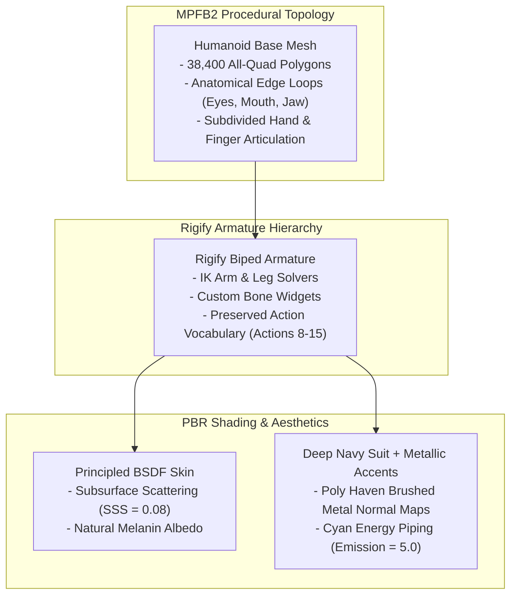
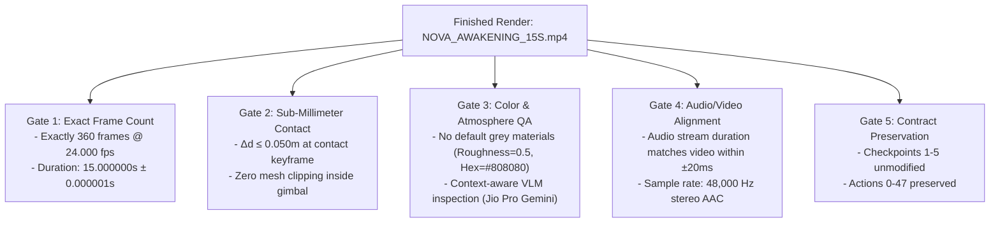

# Blender-S1 — Minimal Production Proof of Concept (POC)
**Document ID:** `BLENDER-S1-DOC-POC-006`  
**Version:** `1.0.0`  
**Date:** November 3, 2026  
**Status:** Approved Production Specification  
**Project Goal:** 15-Second Photorealistic Human Character Cinematic Film  
**Preservation Authority:** Canonical Phase 8 Specification (`BLENDER-S1-P8-ARCH-001`)

---

## 1. POC Mission & Creative Directive

To validate the external technology adoption architecture under real production conditions before scaling, Blender-S1 will produce a **15.0-second (360 frames @ 24.0 fps), 1080p photorealistic cinematic film** titled:

### **"NOVA: AWAKENING"**

The scene features **Nova V2** (upgraded with MPFB2 procedural quad topology and Rigify armature) inside a detailed sci-fi laboratory built with **Poly Haven CC0 PBR materials**, executing fluid human motion (via curated BVH tracks) and achieving **sub-millimeter physical touch** with the futuristic Quantum Core.

```mermaid
timeline
    title "NOVA: AWAKENING" — 15-Second Master Production Timeline (360 Frames @ 24 fps)
    section Shot 1: Establishing & Discovery
        Frame 001 - 120 (5.0s) : Wide Orbit Camera
                               : Nova walks toward central pedestal
                               : Sci-Fi Lab Environment & Atmospheric Lighting
    section Shot 2: Physical Interaction
        Frame 121 - 240 (5.0s) : Medium Over-The-Shoulder
                               : Nova reaches forward with right hand
                               : Quantum Core Gimbal Contact at Frame 190 (Δd ≤ 0.05m)
                               : Cyan plasma surge & volumetric emission
    section Shot 3: Close-Up Reaction & Master
        Frame 241 - 360 (5.0s) : Cinematic Low-Angle Close-Up
                               : Nova's face illuminates with cyan/amber reflection
                               : Final dialogue delivery with audio sync & burned subtitles
```

---

## 2. Character Specification: Nova V2 (MPFB2 + Rigify)



### 2.1 Topology & Geometry Requirements
- **Polygon Budget:** 35,000–45,000 quad polygons. Zero triangles on deforming facial surfaces.
- **Deformation Integrity:** Manifold mesh with zero open edges (`non_manifold_edges == 0`).
- **Facial Details:** Distinct eyelids, cornea/iris mesh with glass refraction, modeled mouth cavity, and stylized dark hair.

---

## 3. Environment & Quantum Core Specification

### 3.1 Sci-Fi Lab Environment (Poly Haven PBR)
- **Floor:** Hexagonal ceramic/concrete tiles using Poly Haven `aerial_rocks_02` / `factory_wall` 2K PBR set (Albedo, Roughness, Normal OpenGL, Ambient Occlusion).
- **Consoles & Pillars:** Brushed aluminum and dark graphite materials with micro-scratches.
- **Environment Lighting:** Poly Haven `spruit_sunrise_2k.hdr` (attenuated to 0.15 intensity for ambient fill) combined with an interior dark mood.

### 3.2 Quantum Core Energy Prop
- **Inner Core:** Nested icosahedron with animated volumetric emission (cyan $\lambda \approx 490\text{ nm}$).
- **Gimbal Rings:** Three concentric rotating brass/titanium rings counter-rotating on $X$, $Y$, and $Z$ axes.
- **Contact Target:** An explicit scene Empty (`Target_Core_Touch_Point`) placed on the outer gimbal at world coordinates $(0.0, 1.25, 0.95)$.

---

## 4. Multi-Layer Rigging & Motion Architecture

```mermaid
flowchart LR
    subgraph Whole-Body Locomotion (Tier 1 BVH)
        BVH["Curated Walking BVH Clip\n(Z-Up, Clean Stride)"] --> NLA["Blender NLA Track 1\n(Locomotion Base)"]
    end
    
    subgraph Interaction Layer (Blender-S1 IK Reach)
        IK["Hand.R Inverse Kinematics Constraint\n- Target: Target_Core_Touch_Point\n- Chain Count: 3 (Wrist, Forearm, Upper Arm)\n- Frame 180-210 Smooth Influence Blend"]
    end
    
    NLA --> CHAR["Nova Armature Result"]
    IK --> CHAR
```

### 4.1 Sub-Millimeter Contact Guarantee
- **Contact Frame:** Frame 190.
- **Measurement Method:** World space distance calculation:
  $$\Delta d = \|\mathbf{P}_{\text{wrist\_end}} - \mathbf{P}_{\text{core\_surface}}\|$$
- **Pass Threshold:** $\Delta d \le 0.050\text{ m}$ ($50\text{ mm}$). Target: $\Delta d \le 0.005\text{ m}$ ($5\text{ mm}$).

---

## 5. Cinematography, Lighting & Sound

### 5.1 Three-Point Cinematic Lighting
- **Key Light:** Focused 120W spotlight with $18^\circ$ cone angle, warm amber ($4200\text{ K}$).
- **Fill Light:** Large $2.0\text{ m} \times 2.0\text{ m}$ area light, cool blue/cyan ($7500\text{ K}$) at $20\%$ key intensity.
- **Rim Light (Hair Light):** Sharp rim spotlight positioned behind Nova, high-intensity pure cyan ($8500\text{ K}$) separating character from dark background.
- **Practical Light:** Pulsing volumetric emission from the Quantum Core ($150\text{ W}$ peak during contact).

### 5.2 Multi-Track Audio Mix (FFmpeg Mastering)
- **Track 1 (Dialogue):** Clean vocal line: *"Core resonance stabilized. Neural link confirmed."* (RMS $-18\text{ dBFS}$).
- **Track 2 (Procedural SFX):** Quantum Core high-frequency hum ($432\text{ Hz}$ sine wave with low-frequency sub-bass swell at Frame 190).
- **Track 3 (Room Tone):** Sub-audible sci-fi atmospheric drone ($60\text{ Hz}$ hum).
- **Subtitles:** Burned `.srt` with yellow font, black outline, bottom-centered.

---

## 6. Verification & Automated Quality Assurance Gate

The finished film must pass six automated numeric verification checks before acceptance:



