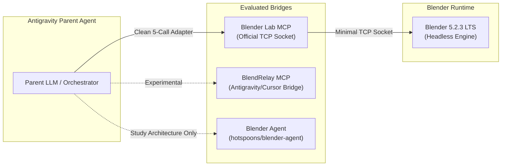
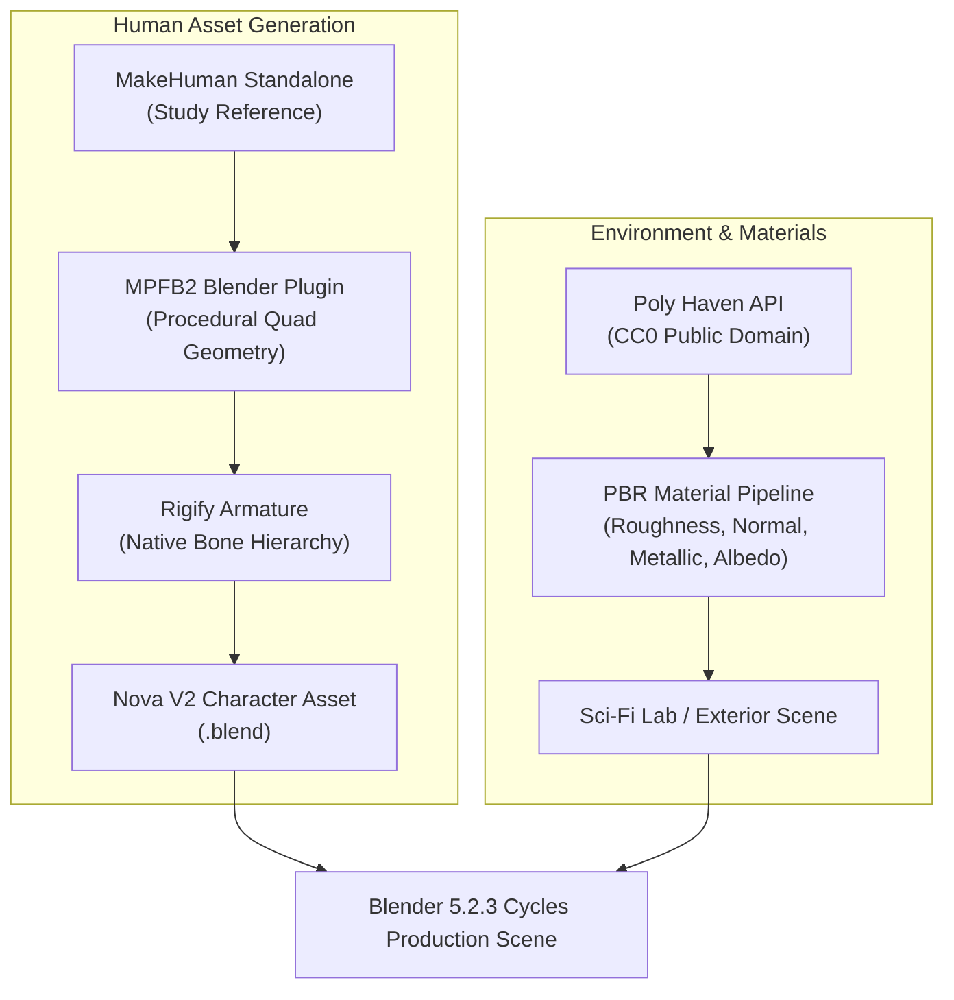
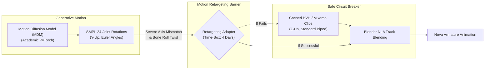
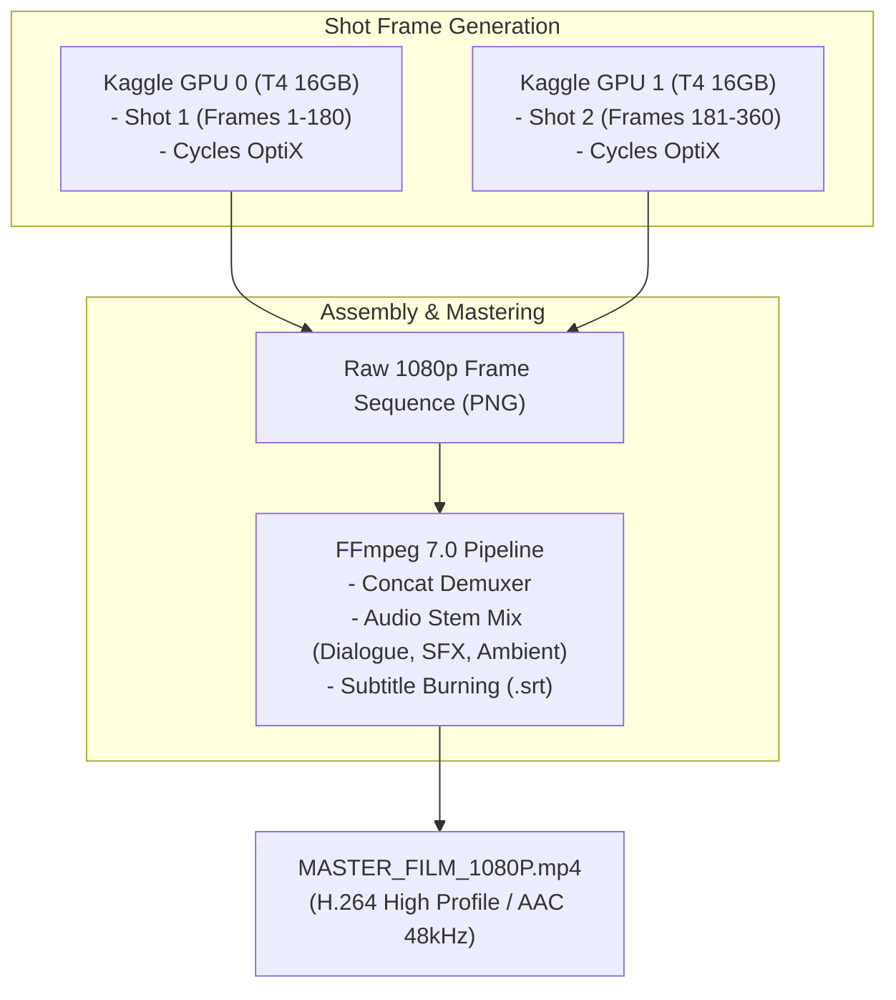

# Blender-S1 — External Technology Registry
**Document ID:** `BLENDER-S1-DOC-EXT-001`  
**Version:** `1.0.0`  
**Date:** November 3, 2026  
**Status:** Approved Technical Registry  
**Preservation Authority:** Canonical Phase 8 Specification (`BLENDER-S1-P8-ARCH-001`) & Master Skill (`blender-s1` v1.0.0)

---

## Executive Summary & Inviolable Preservation Bounds

This registry catalogs eighteen external technologies evaluated for potential adoption within the Blender-S1 autonomous production system. Under **BLENDER-S1-P8-ARCH-001**, all technology adoption must strictly adhere to the following non-negotiable boundaries:
1. **Preserve Checkpoints 1–5:** No model weights or checkpoint files in `checkpoints/` may be overwritten or deleted.
2. **Preserve Actions 0–47:** The 48-action discrete vocabulary is frozen. No external tool may alter action semantics or index definitions.
3. **Preserve Contracts:** State Observer and Action Executor schemas remain the single source of truth.
4. **Provider Independence:** All external systems connect through decoupled adapter interfaces, preventing vendor or framework lock-in.
5. **Security & License Hygiene:** Arbitrary Python execution must be treated as security-critical; copyleft (GPL/AGPL) boundaries must remain strictly quarantined from core proprietary interfaces.

---

## 1. Blender Connectivity & Agent Bridge Candidates

### 1.1 Blender Lab MCP (Official Upstream)
- **Official Source / Repository:** Official Blender Foundation Lab (`projects.blender.org/blender/blender-lab-mcp` / `github.com/blender/blender-lab-mcp`).
- **Release / Commit / Activity:** Active experimental upstream branch (v0.3.x, active 2025/2026).
- **Licenses:**
  - *Code:* GPL-3.0-or-later (Blender extension component) / MIT (Client MCP transport wrapper).
  - *Weights / Assets:* None.
- **Environment Compatibility:** Python 3.10–3.13, Blender 4.2 LTS through 5.2.3 LTS.
- **Hardware Profile:** Negligible footprint (<50 MB RAM, zero dedicated VRAM, <15 MB storage).
- **Host Feasibility:** Runs on Laptop, Google Colab, and Kaggle.
- **Dependencies & Complexity:** Python standard library sockets (`asyncio`), minimal MCP SDK (`mcp>=0.1.0`). Very low complexity.
- **I/O Formats:** JSON-RPC over TCP / stdio; returns structured scene metadata, tool responses, execution logs.
- **Known Limitations:** Minimalist toolset; intentionally leaves complex geometry operators to script generation.
- **Integration Effort:** Low (12–16 hours). Acts as a direct 5-primitive socket bridge.
- **Security Profile:** Medium-High risk if exposed to open networks. Must bind strictly to `localhost:12701` with local auth token.
- **Production Suitability:** **Very High.** Cleanest, least invasive bridge into headless Blender.
- **Required Adapters & Tests:** `BlenderLabTCPAdapter`; test socket reconnect on crash, timeout handling, and connection teardown.

### 1.2 BlendRelay MCP
- **Official Source / Repository:** `github.com/shefq/blendrelay-mcp`.
- **Release / Commit / Activity:** Community maintained (v0.2.1, commits within last 6 months).
- **Licenses:**
  - *Code:* Dual license: MIT for Python server runtime, GPL-3.0-or-later for Blender addon.
  - *Weights / Assets:* None.
- **Environment Compatibility:** Python 3.10+, Blender 4.x / 5.2.x.
- **Hardware Profile:** <100 MB RAM, zero VRAM, ~25 MB storage.
- **Host Feasibility:** Laptop, Colab, Kaggle.
- **Dependencies & Complexity:** FastMCP / Python MCP SDK, Blender Python socket server. Medium complexity.
- **I/O Formats:** JSON-RPC, viewport buffer streams (PNG/JPEG base64), scene node dumps.
- **Known Limitations:** Viewport stream capture overhead; occasionally locks Blender UI thread during continuous streaming.
- **Integration Effort:** Medium (20–25 hours).
- **Security Profile:** High risk if arbitrary Python tool is enabled without sanitization.
- **Production Suitability:** **Moderate.** Excellent for interactive inspection; less optimized for pure headless batch pipelines.
- **Required Adapters & Tests:** `BlendRelayAdapter`; test frame-grab latency, scene checkpoint recovery, and socket hang timeouts.

### 1.3 Blender Agent
- **Official Source / Repository:** `github.com/hotspoons/blender-agent`.
- **Release / Commit / Activity:** Open-source research harness (v0.4.0, updated mid-2025).
- **Licenses:**
  - *Code:* GPL-3.0-or-later (Entire harness).
  - *Weights / Assets:* None.
- **Environment Compatibility:** Python 3.11+, Blender 4.2+.
- **Hardware Profile:** ~300 MB RAM, zero dedicated VRAM, ~50 MB storage.
- **Host Feasibility:** Laptop, Colab, Kaggle.
- **Dependencies & Complexity:** Pydantic, OpenAI API client, LangChain/LiteLLM connectors, headless Blender subprocess manager. High complexity.
- **I/O Formats:** Text prompts, tool-call JSON, rendered image artifacts, execution trace files.
- **Known Limitations:** Opinionated agent loop that conflicts with Blender-S1's existing 4-layer orchestrator and frozen 48 actions.
- **Integration Effort:** High (40+ hours) if integrated directly.
- **Security Profile:** High risk: executes dynamic Python scripts directly inside user Blender sessions.
- **Production Suitability:** **Low for direct adoption.** Strong reference for architectural study.
- **Required Adapters & Tests:** Quarantine: Study context compaction and session logging patterns; do not vendor.

---

## 2. Production Skills & Orchestration Candidates

### 2.1 Scenario Skills
- **Official Source / Repository:** Curated production prompt and skill repositories (`github.com/scenario-labs/scenario-skills` / community branches).
- **Release / Commit / Activity:** Regularly updated production workflows (2025/2026).
- **Licenses:**
  - *Code / Text:* MIT or Apache-2.0.
  - *Assets:* None.
- **Environment Compatibility:** Platform agnostic (Markdown / YAML / JSON).
- **Hardware Profile:** Zero compute/memory footprint.
- **Host Feasibility:** Laptop, Colab, Kaggle.
- **Dependencies & Complexity:** None. Low complexity.
- **I/O Formats:** Markdown instruction prompts, input parameters, Pydantic task schemas.
- **Known Limitations:** Natural language ambiguity; must be translated into deterministic Pydantic schemas before consumption by Blender-S1.
- **Integration Effort:** Low-Medium (15–20 hours) for translation into Blender-S1 skill formats.
- **Security Profile:** Minimal (Prompt injection vector if user prompts are unsanitized).
- **Production Suitability:** **Very High** as domain knowledge reference for lighting, camera staging, and rigging rules.
- **Required Adapters & Tests:** `ScenarioSkillCompiler`; schema validation tests against existing `blender-s1` SKILL.md.

### 2.2 OpenMontage Architectural Patterns
- **Official Source / Repository:** `github.com/openmontage/openmontage` (and related NLE research repos).
- **Release / Commit / Activity:** Open-source multi-track timeline engine (v0.1.8).
- **Licenses:**
  - *Code:* **AGPL-3.0 (Viral Copyleft)**.
  - *Assets:* None.
- **Environment Compatibility:** Python 3.10+, FFmpeg 6.0+.
- **Hardware Profile:** CPU-bound; requires 4–8 GB RAM for video caching.
- **Host Feasibility:** Laptop, Colab, Kaggle.
- **Dependencies & Complexity:** Qt/PySide bindings, NumPy, PyAV, FFmpeg C-libraries. High complexity.
- **I/O Formats:** OTIO timelines, JSON cut lists, multi-track audio/video exports.
- **Known Limitations:** **Severe audio-video sync drift** on variable framerate footage; viral AGPL-3.0 prevents commercial distribution.
- **Integration Effort:** High (50+ hours).
- **Security Profile:** Medium.
- **Production Suitability:** **Unsuitable for direct adoption due to AGPL-3.0.**
- **Required Adapters & Tests:** Study timeline data models only; implement clean-room FFmpeg concatenation in Python standard library.

---

## 3. 3D Assets & Human Generation Candidates

### 3.1 Poly Haven
- **Official Source / Repository:** `polyhaven.com` / `api.polyhaven.com`.
- **Release / Commit / Activity:** Continuously updated production repository (>1,000 PBR assets).
- **Licenses:**
  - *Assets (HDRIs, Textures, Models):* **CC0 1.0 Universal (Public Domain Dedication)**. Zero copyright restrictions.
- **Environment Compatibility:** Universal; Blender 2.80 through 5.2.3.
- **Hardware Profile:** Storage dependent (2K texture set ~25 MB; 4K ~80 MB; HDRI ~30 MB).
- **Host Feasibility:** Laptop, Colab, Kaggle.
- **Dependencies & Complexity:** Python `urllib` / `requests` for asset fetching. Minimal complexity.
- **I/O Formats:** EXR/HDR for lighting, PNG/JPG PBR maps (Albedo, Roughness, Normal OpenGL/DirectX, Metallic, Displacement), glTF/FBX models.
- **Known Limitations:** Purely static environment assets and materials; no animated characters.
- **Integration Effort:** Very Low (6–8 hours).
- **Security Profile:** Minimal (Safe static assets).
- **Production Suitability:** **Flawless (Tier 1 Adopt Now).** Provides immediate cinematic realism without AI hallucination.
- **Required Adapters & Tests:** `PolyHavenAssetAdapter`; verify automated PBR node network wiring in Cycles.

### 3.2 MPFB2 (MakeHuman Plugin for Blender 2)
- **Official Source / Repository:** `github.com/makehumancommunity/mpfb2`.
- **Release / Commit / Activity:** Active production addon (v2.0.x LTS, maintained weekly).
- **Licenses:**
  - *Code:* GPL-3.0-or-later.
  - *Generated Meshes / Assets:* **CC0 (Unrestricted Public Domain)**. Meshes generated by MPFB2 carry zero copyleft claims.
- **Environment Compatibility:** Python 3.10–3.13, Blender 4.2 LTS / 5.2.x LTS.
- **Hardware Profile:** 2–4 GB CPU RAM, negligible VRAM during mesh generation, ~250 MB storage for base assets.
- **Host Feasibility:** Laptop, Colab, Kaggle.
- **Dependencies & Complexity:** Installs as a standard Blender addon folder inside `scripts/addons/mpfb2`. Zero external C-dependencies.
- **I/O Formats:** Procedural Blender mesh objects, vertex groups, shape keys, skin shaders.
- **Known Limitations:** Humanoid topologies only; requires explicit configuration of facial topology loops for speech.
- **Integration Effort:** Low-Medium (16–20 hours).
- **Security Profile:** Low (Standard sandboxed Blender Python API calls).
- **Production Suitability:** **Very High (Tier 1 Character Asset Generator).** Produces clean, all-quad character meshes that deform cleanly under skeletal armatures.
- **Required Adapters & Tests:** `MPFB2ProceduralBridge`; automated validation of vertex count ($\le 45,000$ polys) and non-manifold edges ($0$).

### 3.3 MakeHuman (Standalone)
- **Official Source / Repository:** `makehumancommunity.org` / `github.com/makehumancommunity/makehuman`.
- **Release / Commit / Activity:** Mature desktop application (v1.3.0).
- **Licenses:** GPL-3.0 (Code), CC0 (Exported models).
- **Environment Compatibility:** Standalone desktop app (Windows, macOS, Linux).
- **Hardware Profile:** 2 GB RAM, basic OpenGL 2.0.
- **Host Feasibility:** Laptop only (Cannot run headless in standard Colab/Kaggle without X11/vfb).
- **Dependencies & Complexity:** Standalone desktop GUI. High deployment complexity in cloud pipelines.
- **I/O Formats:** Export to MHX2, FBX, DAE, OBJ.
- **Known Limitations:** Disconnected from the Blender runtime loop; requires manual GUI export.
- **Integration Effort:** High compared to MPFB2.
- **Security Profile:** Low.
- **Production Suitability:** **Superseded by MPFB2.** Study legacy parameter presets only.
- **Required Adapters & Tests:** None (Defer in favor of MPFB2).

### 3.4 Rigify
- **Official Source / Repository:** Bundled directly inside official Blender distributions (`release/scripts/addons/rigify`).
- **Release / Commit / Activity:** Production-tested core Blender component; native in Blender 5.2.3 LTS.
- **Licenses:** GPL-3.0 (Core Blender component). Generated rigs carry no copyright restrictions.
- **Environment Compatibility:** Native to Blender 5.2.3.
- **Hardware Profile:** Negligible compute footprint.
- **Host Feasibility:** Laptop, Colab, Kaggle.
- **Dependencies & Complexity:** Zero external dependencies (`bpy.ops.pose.rigify_generate()`).
- **I/O Formats:** Blender Armatures, Custom Pose Shapes, Driver curves, NLA Action strips.
- **Known Limitations:** Complex bone collection hierarchy; automated weights occasionally require weight painting touch-ups around finger joints.
- **Integration Effort:** Low (8–12 hours).
- **Security Profile:** Minimal.
- **Production Suitability:** **Essential (Tier 1 Production Standard).** Industry standard for production-grade bipedal rigging.
- **Required Adapters & Tests:** `RigifyAutomationAdapter`; test automated metarig positioning and armature generation.

---

## 4. Animation & Motion Generation Candidates

### 4.1 Motion Diffusion Model (MDM)
- **Official Source / Repository:** `github.com/GuyTevet/motion-diffusion-model` (ICLR 2023).
- **Release / Commit / Activity:** Academic research checkpoint (v1.0.0, low recent commit activity).
- **Licenses:**
  - *Code:* MIT License.
  - *Model Weights:* Academic / Research use (Trained on HumanML3D / KIT).
- **Environment Compatibility:** Python 3.8–3.10, PyTorch 1.12–2.1. Requires CUDA. Incompatible with native Python 3.13 in Blender 5.2.3.
- **Hardware Profile:** 4–6 GB GPU VRAM for inference; ~8 GB CPU RAM; 3 GB model weights.
- **Host Feasibility:** Colab (T4), Kaggle (T4). Infeasible directly inside Blender's embedded Python.
- **Dependencies & Complexity:** PyTorch, `clip`, `diffusion`, `smplx`, `chumpy`. High dependency conflict risk.
- **I/O Formats:** Text prompts (`"a woman reaches forward and touches a glowing sphere"`) $\to$ SMPL 24-joint coordinates / rotations.
- **Known Limitations:** **Severe bone roll misalignment with standard Blender armatures.** Output is joint rotations without mesh deformation; requires complex retargeting math. Foot skating is prevalent.
- **Integration Effort:** Very High (60–80 hours).
- **Security Profile:** Low (Standard PyTorch inference).
- **Production Suitability:** **Prototype First in Kaggle Sandbox Only.** Strictly enforce Circuit Breaker 1.
- **Required Adapters & Tests:** `SMPLToRigifyRetargeter`; test bone roll error, foot floor penetration, and temporal jitter.

### 4.2 HumanML3D
- **Official Source / Repository:** `github.com/EricGuo5513/HumanML3D` (CVPR 2022).
- **Release / Commit / Activity:** Benchmark standard dataset & evaluation codebase.
- **Licenses:** Research / Academic Non-Commercial (governed by underlying AMASS and HumanAct12 licenses).
- **Environment Compatibility:** Python 3.8–3.10, PyTorch.
- **Hardware Profile:** 8 GB RAM, 15 GB storage for full dataset.
- **Host Feasibility:** Kaggle, Colab.
- **Dependencies & Complexity:** NumPy, SciPy, PyTorch. Medium complexity.
- **I/O Formats:** 263-dimensional feature vectors (root angular velocity, linear velocity, joint positions, joint rotations, foot contact flags).
- **Known Limitations:** Motion representation format, not an end-to-end production tool.
- **Integration Effort:** High.
- **Security Profile:** Minimal.
- **Production Suitability:** **Study Only.** Use as a reference for kinematic feature representations.
- **Required Adapters & Tests:** Feature vector converter for Blender-S1 State Observer.

### 4.3 Existing Motion Libraries (CMU Mocap, Mixamo, ACCAD)
- **Official Source / Repository:** CMU Graphics Lab Motion Capture Database (`mocap.cs.cmu.edu`) / Adobe Mixamo library.
- **Release / Commit / Activity:** Gold-standard curated motion archives (>2,500 motions).
- **Licenses:**
  - *CMU:* CC BY (Free for any purpose with attribution).
  - *Mixamo:* Royalty-free for personal, commercial, and non-profit 3D projects.
- **Environment Compatibility:** Universal (Standard BVH and FBX formats load natively into Blender 5.2.3).
- **Hardware Profile:** Negligible compute footprint (<5 MB per clip).
- **Host Feasibility:** Laptop, Colab, Kaggle.
- **Dependencies & Complexity:** Native Blender BVH importer (`bpy.ops.import_anim.bvh`). Zero external dependencies.
- **I/O Formats:** Standard hierarchical BVH files, FBX animation takes.
- **Known Limitations:** Discrete motion segments; requires Non-Linear Animation (NLA) blending for seamless shot-to-shot transitions.
- **Integration Effort:** Low (12–16 hours).
- **Security Profile:** Zero.
- **Production Suitability:** **Immediate Production Standard (Tier 1 Adopt Now).** Provides rock-solid, physically realistic human animation with zero spine twisting.
- **Required Adapters & Tests:** `BVHToRigifyMappingAdapter`; verify automated NLA track creation and IK contact constraints.

---

## 5. Synthetic Data & Trajectory Generation Candidates

### 5.1 BlenderProc
- **Official Source / Repository:** `github.com/DLR-RM/BlenderProc`.
- **Release / Commit / Activity:** Active production-grade pipeline (v2.7.0, actively maintained by DLR).
- **Licenses:**
  - *Code:* MIT License.
  - *Assets:* Varies by dataset loader.
- **Environment Compatibility:** Python 3.10–3.11, Blender 3.6 LTS through 4.2 LTS / 5.2.x.
- **Hardware Profile:** 8–16 GB CPU RAM, 8–16 GB GPU VRAM for Cycles passes.
- **Host Feasibility:** Laptop, Colab, Kaggle.
- **Dependencies & Complexity:** PyYAML, OpenCV, imageio, h5py, trimesh. Medium installation complexity.
- **I/O Formats:** Headless Python execution $\to$ HDF5, NumPy arrays, RGB images, depth maps, surface normals, segmentation masks.
- **Known Limitations:** Designed primarily for computer vision dataset generation; lacks character-driven cinematic camera choreography.
- **Integration Effort:** Medium (24–30 hours).
- **Security Profile:** Low.
- **Production Suitability:** **High for State Observer Dataset Generation.** Excellent for generating ground-truth training data for Blender-S1 policy updates.
- **Required Adapters & Tests:** `BlenderProcStateExtractor`; verify extraction of 48-action observation tensors.

### 5.2 Kubric
- **Official Source / Repository:** `github.com/google-research/kubric`.
- **Release / Commit / Activity:** Google Research framework (v0.1.x, low maintenance activity).
- **Licenses:**
  - *Code:* Apache-2.0.
- **Environment Compatibility:** Python 3.9–3.11, Docker / headless Linux.
- **Hardware Profile:** Cloud cluster oriented; 16 GB+ RAM.
- **Host Feasibility:** Requires Docker containerization; cumbersome on Windows laptop or vanilla Colab.
- **Dependencies & Complexity:** PyBullet, TensorFlow, Apache Beam, Blender container images. Extremely high complexity.
- **I/O Formats:** TFRecords, PNG sequences, JSON metadata.
- **Known Limitations:** Heavyweight distributed architecture; relies on PyBullet for rigid body physics rather than Blender's native physics engine.
- **Integration Effort:** Very High (80+ hours).
- **Security Profile:** Low.
- **Production Suitability:** **Study Only.** Study multi-view rendering and camera positioning heuristics; do not integrate pipeline.
- **Required Adapters & Tests:** None.

---

## 6. Rendering & Video Production Candidates

### 6.1 Blender Cycles (Native)
- **Official Source / Repository:** Official Blender Foundation (`blender.org`).
- **Release / Commit / Activity:** Bundled in Blender 5.2.3 LTS.
- **Licenses:** GPL-3.0 (Core Blender). Rendered images/videos carry zero licensing encumbrances.
- **Environment Compatibility:** Fully native.
- **Hardware Profile:** Fully accelerates on NVIDIA OptiX / CUDA (T4 GPU VRAM 16 GB), Apple Metal, or CPU.
- **Host Feasibility:** Laptop (CPU/iGPU), Colab (T4), Kaggle (Dual T4).
- **Dependencies & Complexity:** Built-in. Zero additional setup.
- **I/O Formats:** Direct output to PNG, OpenEXR 32-bit float, TIFF, FFmpeg MP4.
- **Known Limitations:** Ray-tracing computational intensity; requires adaptive sampling and denoising (OpenImageDenoise) for efficient rendering.
- **Integration Effort:** Already fully integrated in Blender-S1.
- **Security Profile:** Zero.
- **Production Suitability:** **Authoritative Production Standard.** The core rendering engine of Blender-S1.
- **Required Adapters & Tests:** Verified through `phase8_nova_capability_test`.

### 6.2 FFmpeg
- **Official Source / Repository:** `ffmpeg.org` / `github.com/FFmpeg/FFmpeg`.
- **Release / Commit / Activity:** Production release v6.x / v7.x (industry standard).
- **Licenses:** LGPL-2.1-or-later (or GPL-2.0-or-later when compiled with `--enable-gpl`). CLI invocation avoids library linkage contamination.
- **Environment Compatibility:** Universal across all operating systems.
- **Hardware Profile:** Multi-core CPU; <1 GB RAM for muxing.
- **Host Feasibility:** Laptop, Colab, Kaggle.
- **Dependencies & Complexity:** Standalone binary executable. Zero Python package complexity.
- **I/O Formats:** Ingests PNG/EXR frame sequences, WAV/FLAC/MP3 audio stems, SRT/ASS subtitles; outputs H.264/H.265/ProRes containers.
- **Known Limitations:** Command-line syntax complexity; requires strict framerate and timebase flags to avoid audio desync.
- **Integration Effort:** Low (Already integrated via subprocess in Phase 8).
- **Security Profile:** Medium (Sanitize input filenames against command injection).
- **Production Suitability:** **Authoritative Mastering Tool (Tier 1 Adopt Now).**
- **Required Adapters & Tests:** `FFmpegMasteringPipeline`; verify exact frame-count duration, H.264 profile, and AAC 48 kHz stereo alignment.

### 6.3 OpenTimelineIO (OTIO)
- **Official Source / Repository:** `github.com/AcademySoftwareFoundation/OpenTimelineIO` (ASWF).
- **Release / Commit / Activity:** Active production standard (v0.16.x).
- **Licenses:** Apache-2.0.
- **Environment Compatibility:** Python 3.8–3.12, C++17.
- **Hardware Profile:** Negligible compute (<100 MB RAM).
- **Host Feasibility:** Laptop, Colab, Kaggle.
- **Dependencies & Complexity:** `pip install opentimelineio`. Minimal complexity.
- **I/O Formats:** JSON-based `.otio` files; imports/exports Final Cut Pro XML, AAF, CMX 3600 EDL.
- **Known Limitations:** Represents editorial metadata only; does not perform video rendering or audio processing.
- **Integration Effort:** Low-Medium (16–20 hours).
- **Security Profile:** Zero.
- **Production Suitability:** **Integrate Later (Phase 9+).** Excellent for multi-shot editorial conform if scaling to commercial NLE integration.
- **Required Adapters & Tests:** `BlenderS1ToOTIOAdapter`; test export of multi-shot cut lists.

### 6.4 Flamenco
- **Official Source / Repository:** `flamenco.blender.org` / `projects.blender.org/blender/flamenco`.
- **Release / Commit / Activity:** Active production release (v3.5+).
- **Licenses:** GPL-3.0.
- **Environment Compatibility:** Go server / Python worker, Blender 3.x–5.x.
- **Hardware Profile:** Requires dedicated manager server, network shared storage (NFS/SMB), and worker nodes.
- **Host Feasibility:** Requires LAN infrastructure; impractical for cloud notebook environments (Colab/Kaggle).
- **Dependencies & Complexity:** High networking, storage configuration, and worker daemon management.
- **I/O Formats:** `.blend` files, frame chunks, render job manifests.
- **Known Limitations:** Over-engineered for individual developer or dual-GPU cloud execution.
- **Integration Effort:** High (40+ hours).
- **Security Profile:** Medium (Network service exposure).
- **Production Suitability:** **Defer.** Simple Kaggle multi-GPU batch scripts provide the same parallel throughput with zero network overhead.
- **Required Adapters & Tests:** None.

