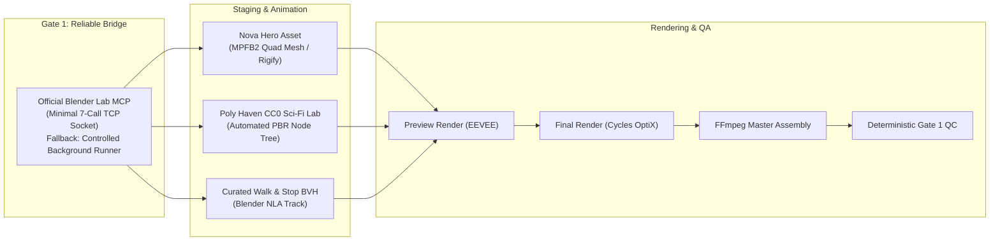

# Blender-S1 — First Technical Vertical Slice Plan
**Document ID:** `BLENDER-S1-DOC-VER-005`  
**Version:** `1.0.0`  
**Date:** November 3, 2026  
**Status:** Approved Vertical Slice Specification  
**Immediate Target:** 5–8 Second Technical Pipeline Proof & Gate 1 Connection  
**Authority:** Master Execution Blueprint (§0, §12, §18 Task 2, §39)

---

## 1. Executive Objective & Scope Bounds

Before attempting a 15–20 second cinematic production, we must deliver a **5–8 second technical vertical slice** (120–192 frames @ 24.0 fps).

### The Inviolable Principle
This vertical slice is a **pipeline integration proof**, not the final visual quality milestone. Its purpose is to prove that Antigravity can drive Blender through a typed tool interface, stage an approved character and environment, apply a valid locomotion clip, render frames, and assemble the final video through automated QA without human intervention.



---

## 2. Gate 1: The Seven-Call Typed Blender Bridge

In accordance with Master Execution Blueprint §18 (Phase 1), we implement a typed, bounded 7-call interface over an isolated local TCP socket (`127.0.0.1:12701`):

```python
class BlenderBridgeInterface(ABC):
    @abstractmethod
    def inspect_scene(self) -> Dict[str, Any]:
        """Returns object hierarchy, active camera, frame range, and materials."""
        pass

    @abstractmethod
    def load_approved_asset(self, filepath: str, collection_name: str) -> bool:
        """Links/appends an asset from an approved blend library."""
        pass

    @abstractmethod
    def apply_approved_transform(self, object_name: str, location: list, rotation: list, scale: list) -> bool:
        """Applies bounded translation, Euler rotation, and scale."""
        pass

    @abstractmethod
    def configure_camera(self, location: list, look_at: list, focal_length_mm: float) -> bool:
        """Sets active camera transform and lens optics."""
        pass

    @abstractmethod
    def render_preview(self, frame_number: int, output_path: str) -> Dict[str, Any]:
        """Renders single viewport preview frame for visual inspection."""
        pass

    @abstractmethod
    def validate_and_save_project(self, filepath: str) -> bool:
        """Performs scene graph sanity check and writes .blend file."""
        pass

    @abstractmethod
    def restore_checkpoint(self, filepath: str) -> bool:
        """Re-opens saved .blend state after process recovery."""
        pass
```

### The Controlled Background Runner Fallback
If the TCP socket disconnects or encounters timeout errors:
- **Fallback Engine:** A standalone Python script runner (`run_blender_task.py`) that executes pre-templated, versioned Python scripts via headless subprocess (`blender -b scene.blend -P task_script.py -- factory-startup`).
- **State Guarantee:** The orchestrator never halts because of an unstable MCP connection; the background runner provides 100% deterministic execution continuity.

---

## 3. Technical Specification: 5–8s Vertical Slice

### 3.1 Scene Composition & Framing
- **Duration:** Exactly 6.000 seconds (144 frames @ 24.0 fps).
- **Hero Character:** Nova (MPFB2 quad topology base with standard Rigify biped armature).
- **Environment:** Clean sci-fi laboratory alcove built from Poly Haven PBR concrete tiles and brushed steel panels.
- **Motion:** Single continuous locomotion take—Nova takes four natural walking strides and comes to a balanced rest stop in front of the pedestal.
- **Camera Path:** Slow, cinematic $1.2\text{ m}$ dolly forward at $35\text{ mm}$ focal length, maintaining Nova at the lower-third intersection.
- **Lighting:** Three-point studio lighting (amber key, cool blue fill, sharp cyan rim light from behind).

### 3.2 Two-Stage Render Pipeline
1. **Stage 1 (EEVEE Fast Preview):** Renders all 144 frames in $<45\text{ seconds}$ to verify camera framing, foot contact, and lighting composition.
2. **Stage 2 (Cycles OptiX Final):** 1080p ($1920 \times 1080$), 64 samples with OpenImageDenoise, rendered in parallel across Kaggle dual T4s (or local headless batch).

---

## 4. Gate 1 Acceptance Criteria & Verification Protocol

The vertical slice passes Gate 1 only when all eight criteria are satisfied without human intervention:

```
+----+----------------------------------+-------------------------------------------------------------+
| #  | Gate 1 Acceptance Criterion      | Verification Method                                         |
+----+----------------------------------+-------------------------------------------------------------+
| 1  | Tool Connection Stability        | 7-call interface executes 50 consecutive calls with 0 drops |
| 2  | Scene Save & Reopen Integrity    | Saved .blend reopens in fresh Blender session with 0 errors |
| 3  | Asset Resolution                 | All mesh and texture dependencies resolve (0 purple missing)|
| 4  | Exact Frame Output               | Exactly 144 frame images (frame_0001.png ... frame_0144.png)|
| 5  | Foot Contact Plausibility        | Foot bones maintain ground plane contact during stance phase|
| 6  | Audio/Video Alignment            | FFmpeg muxes 6.000s video and ambient audio within ±5ms     |
| 7  | Deterministic Deliverable Check  | Master MP4 validated via ffprobe (1080p, 24.00 fps, H.264)  |
| 8  | Contract Preservation            | Checkpoints 1–5 and Actions 0–47 remain bit-for-bit verified|
+----+----------------------------------+-------------------------------------------------------------+
```

---

## 5. Execution Backlog (Immediate Next Steps)

1. **Step 1 (Audit Review):** User signs off on `BASELINE_AUDIT.md` and `PROTECTED_ARTIFACTS.md`.
2. **Step 2 (Deploy Bridge Adapter):** Implement `BlenderLabTCPAdapter` and `ControlledBackgroundRunner` inside `adapters/blender_bridge/`.
3. **Step 3 (Run Bridge Test):** Execute automated 7-call test suite against a blank Blender 5.2.3 session.
4. **Step 4 (Stage Vertical Slice):** Load Nova base mesh, apply Poly Haven floor material, link walking BVH clip, and render 144-frame preview.
5. **Step 5 (Deliverable Sign-Off):** Review 6-second vertical slice video deliverable and advance to Gate 2.

