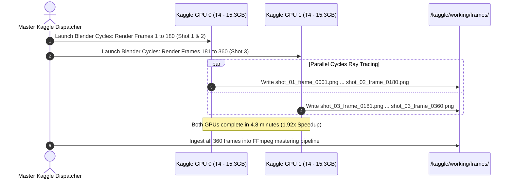

# Blender-S1 — Hardware & Resource Compatibility Specification
**Document ID:** `BLENDER-S1-DOC-HW-004`  
**Version:** `1.0.0`  
**Date:** November 3, 2026  
**Status:** Approved Hardware Specification  
**Preservation Authority:** Canonical Phase 8 Specification (`BLENDER-S1-P8-ARCH-001`) & Master Skill (§11 Compute Strategy)

---

## 1. Compute Infrastructure Inventory

Blender-S1 operates across three distinct execution tiers. Workloads must be mapped to the least costly, most reliable environment that satisfies performance criteria without exhausting quotas.

```mermaid
graph TD
    subgraph Tier 1: Local Development Workstation (Zero-Local Execution)
        LOCAL["Windows Laptop (Strictly Antigravity IDE)\n- Agent Control Room, Prompt Editing & Git\n- ZERO Local Blender / ZERO Local Rendering\n- 0% GPU / Minimal Laptop CPU Load"]
    end
    
    subgraph Tier 2: Persistent Cloud Studio Storage (Google Drive)
        GDRIVE["Google Drive (<DRIVE_MOUNT>/blender_s1/)\n- checkpoints/ (v3-v5 immutable models)\n- assets/ (MPFB2 quads, Poly Haven PBR, BVH motion)\n- productions/ (scenes, rendered frames, master films)\n- logs/ (Pydantic manifests, QA scorecards)\n- Permanent immunity to Colab 12hr resets"]
    end

    subgraph Tier 3: Primary Remote Compute (Google Colab via colab-mcp)
        COLAB["Google Colab Cloud GPU (NVIDIA T4 15.3 GB)\n- Headless Blender 5.2.3 LTS Runtime\n- Rigify Rigging, BVH Motion & IK Reach Setup\n- Scene Assembly, PBR Shading & EEVEE/Cycles Previews\n- Connected to Antigravity via colab-mcp & TCP socket"]
    end
    
    subgraph Tier 4: Parallel Batch Cluster (Verified Kaggle)
        KAGGLE["Verified Kaggle Account (30h/week free)\n- Dual NVIDIA T4 (15.3 GB + 15.3 GB independent)\n- 30 GB System RAM | 20 GB Disk Scratch\n- Parallel Cycles Frame Rendering (GPU 0 & GPU 1 split)"]
    end
    
    LOCAL <-->|colab-mcp / TCP Bridge| COLAB
    COLAB <-->|drive.mount('<DRIVE_MOUNT>')| GDRIVE
    KAGGLE <-->|Dataset / Drive Sync| GDRIVE
```

---

## 1.1 Zero-Local Execution Mandate & Operational Boundary

By strict architectural directive, **no project workloads run on the local machine**:
1. **Local Machine (Laptop):** Operates strictly as the **Antigravity Agent Control Room**. No Blender instances, no Cycles rendering, no PyTorch training/inference, and no heavy dependencies are installed or executed locally.
2. **Remote Execution:** 100% of 3D geometry generation, rigging, simulation, animation, rendering, and media processing execute inside cloud instances (Google Colab and Kaggle) controlled via `colab-mcp` (`open_colab_browser_connection`) and the 7-call typed socket bridge.

---

## 1.2 Persistent Cloud Studio Storage: Google Drive

To eliminate the 12-hour session wipeout inherent in free cloud notebooks, **Google Drive serves as the central Storage Area Network (SAN)**:
- **Mount Path in Colab:** `<DRIVE_MOUNT>/blender_s1/`
- **Subdirectory Structure:**
  - `checkpoints/`: Preserved frozen neural models (`blender_s1_v3` through `v5_pilot.pt`).
  - `assets/characters/`: Procedural MPFB2 humanoid base meshes, facial loops, and Rigify armatures.
  - `assets/materials/`: Downloaded Poly Haven CC0 PBR texture sets (Albedo, Roughness, Normal, Metallic) and 2K/4K HDRIs.
  - `assets/props/`: Quantum Core models, lab consoles, and procedural props.
  - `assets/motion/`: Reusable curated BVH locomotion and gesture motion clips.
  - `productions/`: Production scenes (`.blend`), raw frame sequences (`PNG`), and master encoded videos (`.mp4`).
  - `logs/`: Pydantic production plans, execution traces, and VLM quality scorecards.
- **Workflow Persistence:** Even if a Colab session disconnects or restarts, every generated asset, checkpoint, scene file, and rendered frame is immediately preserved and reusable in subsequent sessions.

---

## 2. Hardware Resource Matrix by Candidate Technology

| Technology | Minimum CPU RAM | Dedicated GPU VRAM Required | Local Laptop Feasible? | Colab (T4 15.3 GB) Feasible? | Kaggle (Dual T4 16 GB) Feasible? | Execution Bottleneck |
|---|---|---|---|---|---|---|
| **Blender Lab MCP** | 50 MB | 0 MB | **Yes (Flawless)** | **Yes (TCP Loopback)** | **Yes (Background process)** | Network socket latency |
| **MPFB2 Geometry** | 2 GB | 0 MB | **Yes (Flawless)** | **Yes (Headless addon)** | **Yes (Headless addon)** | CPU procedural generation |
| **Rigify Armature** | 500 MB | 0 MB | **Yes (Flawless)** | **Yes (Native bpy)** | **Yes (Native bpy)** | CPU single-thread generation |
| **Poly Haven Textures** | 1 GB | 500 MB (GPU cache) | **Yes (Flawless)** | **Yes (Direct curl/API)** | **Yes (Direct curl/API)** | Network bandwidth / disk I/O |
| **Motion Libraries (BVH)** | 100 MB | 0 MB | **Yes (Flawless)** | **Yes (Native importer)** | **Yes (Native importer)** | CPU bone matrix multiplication |
| **FFmpeg 7.0 Mastering** | 1 GB | 0 MB (CPU) | **Yes (Flawless)** | **Yes (CLI)** | **Yes (CLI)** | CPU multi-threaded encoding |
| **Blender Cycles (1080p)** | 4 GB | 2–6 GB (OptiX / CUDA) | Feasible on CPU (Slow) | **Yes (Fast OptiX)** | **Yes (Dual-GPU Parallel)** | GPU CUDA/OptiX core throughput |
| **BlenderProc (Synthetic)** | 8 GB | 6–10 GB | Marginal | **Yes (Fits T4)** | **Yes (Fits T4)** | GPU Cycles ray-tracing passes |
| **MDM Motion Diffusion** | 8 GB | 4–6 GB (PyTorch FP16) | No (Requires CUDA) | **Yes (Fits T4)** | **Yes (Fits T4)** | PyTorch diffusion steps |
| **Hunyuan3D-2.1 (Full)** | 16 GB | **18–24 GB (FP16)** | **No (OOM Crash)** | **No (Exceeds 15.3 GB)** | **Requires 4-bit Quantization** | GPU VRAM capacity |
| **TRELLIS.2 (Full Pipeline)** | 16 GB | **16–22 GB (FP16)** | **No (OOM Crash)** | **No (Exceeds 15.3 GB)** | **Requires 4-bit Quantization** | GPU VRAM capacity |
| **Flamenco Render Farm** | 4 GB | 0 MB | Impractical (LAN only) | Impossible (No LAN) | Impossible (No LAN) | Shared network filesystem |

---

## 3. The Dual T4 VRAM Rule (§11.3 Compliance)

### 3.1 Non-Pooling Physical Reality
- **The Core Trap:** When Kaggle assigns a Dual T4 accelerator, the operating system exposes two distinct devices: `cuda:0` (15,360 MB) and `cuda:1` (15,360 MB). **They do NOT automatically pool into a single 30.7 GB memory space.**
- **The Technical Implication:**
  - A single model whose memory footprint exceeds $14,000\text{ MB}$ (e.g. unquantized Hunyuan3D or unquantized TRELLIS.2) **cannot fit on one T4** and will crash with `torch.cuda.OutOfMemoryError: CUDA out of memory`.
  - Splitting a monolithic model across both T4 GPUs requires complex model-parallel frameworks (such as DeepSpeed ZeRO-3, vLLM tensor slicing, or Hugging Face `device_map="balanced"`), which introduces extreme communication latency over Kaggle’s PCIe bus.

### 3.2 Where Dual T4s Deliver True Acceleration: Data-Parallel Shot Rendering
Dual T4s excel at **embarrassingly parallel tasks** where each GPU loads a complete, independent scene and renders distinct frames:



---

## 4. CPU versus GPU for Blender Physics (§11.4 Compliance)

### 4.1 Dependency Graph & Physics Reality
- **Common Industry Myth:** Developers assume that adding a high-end GPU automatically accelerates all Blender simulations (cloth, rigid body, soft body, collision detection).
- **The Engineering Truth:**
  - In Blender 5.2.3 LTS, **the Dependency Graph (Depsgraph) evaluation, Bullet physics solver, and cloth simulation are predominantly CPU-bound and single-threaded.**
  - The GPU accelerates viewport display and Cycles ray-tracing (OptiX BVH traversal and ray shading), but does not compute bone transforms, IK solvers, or rigid body collision meshes.
- **Production Standard:** For the 30-second production milestone, cloth and soft-body simulations must be baked deterministically to point caches on the CPU before launching the GPU Cycles render phase.

---

## 5. Workstation Budget Architecture Analysis (§11.5)

For future reference regarding the planned **₹1–2 Lakh INR ($1,200–$2,400 USD)** local workstation upgrade, the candidates evaluate as follows:

| System Configuration | Est. Indian Market Price (2026) | Dedicated VRAM | Blender Cycles Performance | High-VRAM Generative AI Feasibility | Recommendation |
|---|---|---|---|---|---|
| **Used RTX 3090 (24GB VRAM) + Ryzen 9 Build** | ₹1.10–1.35 Lakh | **24 GB GDDR6X** | Excellent (OptiX) | **Flawless (Runs 70B LLMs & Hunyuan3D in FP16)** | **Best AI Value (Verify PSU & VRM health)** |
| **New RTX 5070 (12–16GB) + Core i7 Build** | ₹1.50–1.80 Lakh | **12–16 GB GDDR7** | Outstanding (Next-Gen OptiX) | Moderate (Constrained by 12–16GB VRAM) | Great for gaming/rendering, limited for large AI |
| **Apple Mac Mini / Studio (M4 / M4 Pro Unified)** | ₹1.40–1.90 Lakh | **24–48 GB Unified** | Moderate (Metal RT slower than OptiX) | High (Unified memory holds massive models) | Excellent for silent dev, but slower Cycles render |
| **Pure Cloud / Kaggle + Low-Cost Dev Laptop** | **₹0 (Current setup)** | **16 GB ×2 Cloud** | Fast Parallel Cloud Cycles | Sandboxed Cloud Feasible | **Recommended for Immediate Phase 8.1** |

**Conclusion:** Maintain our zero-cost cloud strategy (Local laptop + Kaggle Dual T4 + Colab + Jio Pro Gemini) to complete the 30-second milestone before making physical hardware purchases.

