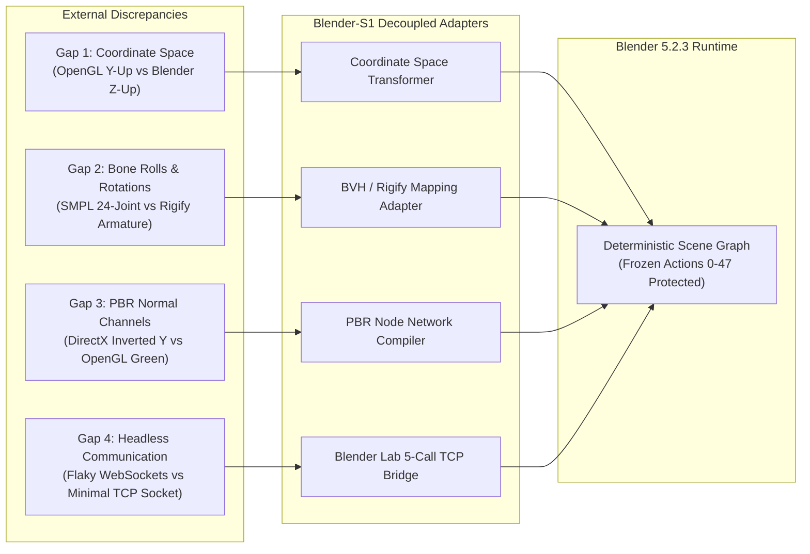

# Blender-S1 — Integration Gap Analysis & Adapter Architecture
**Document ID:** `BLENDER-S1-DOC-GAP-005`  
**Version:** `1.0.0`  
**Date:** November 3, 2026  
**Status:** Approved Integration Specification  
**Preservation Authority:** Canonical Phase 8 Specification (`BLENDER-S1-P8-ARCH-001`) & Frozen Actions 0–47

---

## 1. The "Integration Glue Tax" Root Cause Analysis

When open-source technologies are integrated into an autonomous production pipeline, silent mathematical and semantic discrepancies create severe points of failure. This document identifies the five fundamental friction gaps and defines the decoupled adapter interfaces that bridge them.



---

## 2. Deep Dive: The Five Integration Gaps

### Gap 1: Coordinate Space and Handedness Inversions
- **The Problem:** 
  - Most external computer vision models (MDM, Hunyuan3D, PyBullet, OpenCV) operate in a **Right-Handed, Y-Up coordinate system** ($+Y$ is up, $+Z$ points out of the screen toward the camera, $+X$ is right).
  - Blender operates strictly in a **Right-Handed, Z-Up coordinate system** ($+Z$ is up, $+Y$ points forward into the scene, $+X$ is right).
- **Failure Mode:** Importing raw external geometry or translation vectors causes characters to spawn lying flat on their backs or camera frustums to point directly at the ceiling.
- **The Adapter Fix (`CoordinateTransformer`):**
  Apply a deterministic $90^\circ$ rotation matrix around the $X$-axis:
  $$\begin{bmatrix} X_{\text{blender}} \\ Y_{\text{blender}} \\ Z_{\text{blender}} \end{bmatrix} = \begin{bmatrix} 1 & 0 & 0 \\ 0 & 0 & -1 \\ 0 & 1 & 0 \end{bmatrix} \begin{bmatrix} X_{\text{ext}} \\ Y_{\text{ext}} \\ Z_{\text{ext}} \end{bmatrix}$$

---

### Gap 2: Bone Hierarchies, Euler Rotations, and Bone Rolls
- **The Problem:** 
  - Generative motion models (MDM, HumanML3D) use the **SMPL kinematic tree** (24 spherical joints defined as rotation matrices or $6\text{D}$ continuous rotation representations relative to a parent joint).
  - Blender Rigify armatures use **edit-bone roll vectors, head/tail coordinates, and local coordinate spaces** aligned along the bone axis ($+Y$ along the bone length).
- **Failure Mode:** 
  - Mapping raw SMPL quaternions directly to Blender pose bones causes **severe $90^\circ$ spine snaps, inside-out limb twisting, and catastrophic foot floating**.
  - Euler gimbal lock causes extreme temporal jitter.
- **The Adapter Fix (`BVHToRigifyMappingAdapter` & Circuit Breaker 1):**
  1. For immediate production (Tier 1), use pre-retargeted standard biped BVH clips whose bone rolls are pre-aligned with Rigify’s rest pose.
  2. For experimental MDM motion (Tier 2 in Kaggle), apply an intermediate rest-pose calibration matrix ($R_{\text{rest}}^{-1} \cdot R_{\text{target}} \cdot R_{\text{rest}}$) and clamp foot joints to the floor using Blender’s native Floor and IK constraints. If bone roll calibration takes $>4$ days, trigger Circuit Breaker 1.

---

### Gap 3: PBR Material Node Graphs and Normal Map Inversions
- **The Problem:**
  - Raw downloaded 3D assets or texture libraries often bundle normal maps formatted for DirectX ($+Y$ down / inverted green channel), while Blender Cycles requires OpenGL normal maps ($+Y$ up / normal green channel).
  - Albedo textures are often incorrectly connected as Non-Color data, or roughness maps are plugged into metallic inputs.
- **Failure Mode:** Inverted normal lighting (crevices appear as raised bumps) and unnatural plastic reflections.
- **The Adapter Fix (`PolyHavenPBRAdapter`):**
  A deterministic Python node-tree builder that:
  1. Creates a `ShaderNodeBsdfPrincipled`.
  2. Sets color spaces automatically: Albedo $\to$ `sRGB`; Roughness, Normal, Metallic $\to$ `Non-Color`.
  3. Inserts an automated `ShaderNodeSeparateColor` $\to$ `Invert (Green)` node if a DirectX normal map is detected.

---

### Gap 4: Headless Communication, Process Lifecycle, and Crashes
- **The Problem:**
  - Third-party agent frameworks (e.g. BlendRelay or Blender Agent) attempt to maintain persistent bidirectional WebSockets or interactive viewport streaming. If a headless Blender instance hits a segmentation fault during a heavy physics bake or Cycles render, the client hangs indefinitely.
- **The Adapter Fix (`BlenderLabTCPAdapter`):**
  - Implement a clean 5-primitive RPC interface over a local TCP socket (`127.0.0.1:12701`):
    1. `load_asset(filepath: str, collection_name: str) -> bool`
    2. `set_transform(object_name: str, location: list, rotation: list, scale: list) -> bool`
    3. `set_camera(location: list, target: list, focal_length: float) -> bool`
    4. `render_preview(frame: int, output_path: str) -> dict`
    5. `open_mainfile(filepath: str) -> bool`
  - Subprocess supervisor wraps the socket with a 30-second heartbeat and auto-restart fallback.

---

### Gap 5: Preservation of Frozen 48-Action Vocabulary (Actions 0–47)
- **The Problem:** External tools frequently attempt to introduce high-level composite commands (e.g., `generate_entire_city()`, `animate_crowd()`) that violate Blender-S1's discrete learned execution policy.
- **The Adapter Fix:**
  - All external tools operate strictly as **Layer 2 / Layer 4 asset providers or deterministic runtime helpers**.
  - Blender-S1's learned policy continues to select actions strictly within the established 48-action space:

```mermaid
graph TD
    subgraph Frozen Action Subspaces (Actions 0-47)
        A0_7["Actions 0-7: Asset & Scene Manipulation\n(Spawn, Transform, Parent, Delete)"]
        A8_15["Actions 8-15: Rigging & Armature\n(Metarig Init, Bone Assign, IK Setup, Weights)"]
        A16_23["Actions 16-23: Material & Shading\n(Principled BSDF, Emission, Color, Roughness)"]
        A24_31["Actions 24-31: Camera & Lighting\n(Focal Length, TrackTo, Sun, Point Light)"]
        A32_39["Actions 32-39: Animation & Keyframing\n(LocRotScale Key, Pose Key, Interp Mode)"]
        A40_47["Actions 40-47: Simulation & Rendering\n(Rigid Body, Cloth, Cycles Denoise, Frame Output)"]
    end
    
    EXT["External Technology Ingestion\n(MPFB2, Poly Haven, Mixamo BVH)"] -->|Furnishes Clean Targets\n& Material Properties| A0_7
    EXT -->|Supplies Base Metarig| A8_15
    EXT -->|Supplies PBR Image Textures| A16_23
    EXT -->|Supplies Keyframe BVH Curves| A32_39
```

