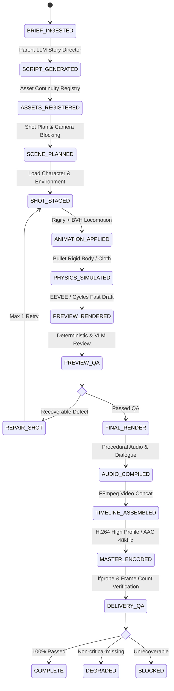

# Blender-S1 — Phase 8 Contract Architecture Map
**Document ID:** `BLENDER-S1-DOC-CON-002`  
**Version:** `1.0.0`  
**Date:** November 3, 2026  
**Status:** Approved Architecture Contract Map  
**Authority:** Master Execution Blueprint (§39) & Canonical Phase 8 Specification (`BLENDER-S1-P8-ARCH-001`)

---

## 1. System Contract Hierarchy

Phase 8 establishes a strict contract hierarchy between the Parent LLM (Layer 1), the Production Orchestrator (Layer 2), the Execution Policy (Layer 3), and the Blender Runtime (Layer 4).

```mermaid
graph TD
    UserBrief["Creative Brief"] --> Layer1["Layer 1: AI Creative Director (LLMClient)"]
    Layer1 --> Layer2["Layer 2: Production Orchestrator (16-Stage State Machine)"]
    
    subgraph Pydantic Contracts (blender_s1_v8.schemas)
        S1["VideoBrief (v1.0.0)"]
        S2["StoryScript (v1.0.0)"]
        S3["CharacterBible (v1.0.0)"]
        S4["AssetManifest (v1.0.0)"]
        S5["ScenePlan (v1.0.0)"]
        S6["ShotPlan (v1.0.0)"]
        S7["BlenderTaskPlan (v1.0.0)"]
        S8["AnimationPlan (v1.0.0)"]
        S9["AudioPlan (v1.0.0)"]
        S10["TimelinePlan (v1.0.0)"]
        S11["RenderManifest (v1.0.0)"]
        S12["QualityReport (v1.0.0)"]
    end
    
    Layer2 --> S1 & S2 & S3 & S4 & S5 & S6
    Layer2 --> Layer3["Layer 3: Policy Execution (Actions 0-47)"]
    Layer3 --> Layer4["Layer 4: Blender 5.2.3 Runtime"]
    Layer4 --> S11
    Layer2 --> Layer5["Layer 5: FFmpeg Video & Audio Assembly"]
    Layer5 --> S12
```

---

## 2. Mapping: Canonical Specification to Implementation Files

| Layer | Canonical Architecture Role | Repository Source File | Tested Capabilities |
|---|---|---|---|
| **Layer 1** | AI Creative Director | `blender_s1_v8/parent_llm.py` | Provider-independent `LLMClient`, role prompts for Story, Character, Camera, Lighting, Sound |
| **Layer 2** | Production Schemas | `blender_s1_v8/schemas.py` | 12 versioned Pydantic models (v1.0.0) enforcing strict JSON validation |
| **Layer 2** | Production Orchestrator | `blender_s1_v8/orchestrator.py` | 16-stage state machine, per-shot isolation, retry/repair limits |
| **Layer 3** | Asset Continuity Registry | `blender_s1_v8/asset_registry.py` | SQLite/JSON persistent registry tracking asset paths, scale, and rig IDs |
| **Layer 4** | Execution Policy | `checkpoints/blender_s1_v5_pilot.pt` | 48 discrete actions, dynamic bone/object pointers, continuous parameter heads |
| **Layer 5** | Blender Runtime | `bpy 5.2.3 LTS` (Headless) | Armature deform, Cycles ray tracing, IK solvers, physics bake |
| **Layer 6** | Audio Engine | `blender_s1_v8/audio_engine.py` | Procedural SFX generation, dialogue stem timing, `.srt` subtitle generator |
| **Layer 7** | Video Assembly | `blender_s1_v8/video_assembly.py` | Multi-track FFmpeg timeline muxing, burned subtitles, audio-video sync |
| **Layer 8** | Quality Assurance | `blender_s1_v8/schemas.py::QualityReport`| Deterministic ffprobe validation, frame-count verification, QC verdict |

---

## 3. The 16-Stage Persistent State Machine

The workflow in `blender_s1_v8/orchestrator.py` implements a durable 16-stage state machine that isolates failures to individual shots:



### Shot-Level Isolation Invariant
A failure in Shot $K$ triggers repair exclusively for Shot $K$. Completed, verified frames for Shots $1 \dots K-1$ are stored in `renders/shot_{id}/` and are never re-rendered, preserving GPU time and compute budget.

---

## 4. Provider-Independent Parent LLM Interface

In `blender_s1_v8/parent_llm.py`, the AI Creative Director connects through an abstract base class (`LLMClient`) that decouples model inference from specific cloud vendors:

```python
class LLMClient(ABC):
    @abstractmethod
    def generate_structured(
        self,
        prompt: str,
        schema: Type[BaseModel],
        role_prompt: str
    ) -> BaseModel:
        """Generates validated structured data conforming to a Pydantic schema."""
        pass
```

### Approved Provider Implementations
1. **GeminiLLMClient (Primary):** Powered by Jio Pro Gemini API (`gemini-1.5-pro` / `gemini-1.5-flash`), with 2M token context, high rate limits, and native multimodal frame evaluation.
2. **DeterministicFallbackLLMClient (Offline / CI):** Ingests pre-templated, verified JSON manifests for offline testing when external network access is disabled.
3. **Claude / OpenAI Adapters (Alternative):** Implemented for portability without architectural rewrites.

---

## 5. Contract Preservation Invariants

All future technology adoption must maintain these contract rules:
1. **Schema Versioning:** Any schema evolution must increment `version: "1.1.0"` without breaking existing fields.
2. **No Arbitrary Code Output:** Parent LLM must return validated JSON matching `blender_s1_v8.schemas`; it is forbidden from outputting raw unconstrained Python strings directly to the runtime.
3. **Single-Writer Scene Mutation:** Only the Layer 2 Orchestrator may dispatch commands to the Blender process. No parallel agents may write to the active `.blend` file simultaneously.

