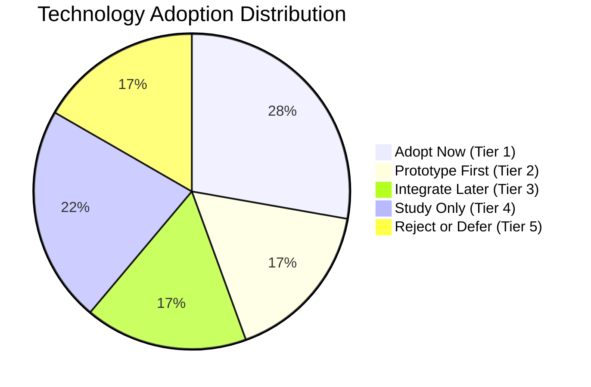

# Blender-S1 — Technology Adoption Matrix
**Document ID:** `BLENDER-S1-DOC-MAT-002`  
**Version:** `1.0.0`  
**Date:** November 3, 2026  
**Status:** Approved Adoption Strategy  
**Preservation Authority:** Canonical Phase 8 Specification (`BLENDER-S1-P8-ARCH-001`)

---

## 1. Executive Classification & Prioritization

Every candidate technology is rigorously categorized into one of five actionable adoption tiers based on empirical feasibility, license boundaries, VRAM profiles, and preservation of the Blender-S1 execution contract.

---

## 2. Master Technology Classification Matrix

| Technology | Category | Classification Tier | Strategic Approach | Primary Capability | Risk Level | Target Phase | Contract & Checkpoint Impact |
|---|---|---|---|---|---|---|---|
| **Poly Haven** | Assets / Textures | **Adopt Now** | **Reuse** | Photorealistic CC0 PBR textures, metals & HDRIs | Low | Immediate (Phase 8.1) | Zero impact. Ingested via standard Blender material nodes. |
| **MPFB2** | Character Topology | **Adopt Now** | **Integrate** | Procedural, all-quad humanoid mesh generation | Low | Immediate (Phase 8.1) | Zero impact. Produces clean mesh object for Nova V2. |
| **Rigify** | Character Rigging | **Adopt Now** | **Reuse** | Production-grade bipedal armature with IK/FK | Low | Immediate (Phase 8.1) | Zero impact. Enhances Actions 10–15 without altering vocabulary. |
| **Motion Libraries (CMU/Mixamo)** | Animation | **Adopt Now** | **Reuse** | Clean, natural human locomotion & gesture clips | Low | Immediate (Phase 8.1) | Zero impact. Drives bones via standard NLA action tracks. |
| **FFmpeg** | Mastering | **Adopt Now** | **Reuse** | Frame muxing, multi-track audio mix, burned subtitles | Low | Immediate (Phase 8.1) | Zero impact. Standalone CLI subprocess. |
| **Blender Lab MCP** | Connectivity | **Adopt Now** | **Integrate** | Official upstream minimal TCP socket bridge | Medium | Immediate (Phase 8.1) | Zero impact. External transport for Antigravity commands. |
| **BlenderProc** | Synthetic Data | **Prototype First** | **Integrate** | Ground-truth depth/normal passes & 48-action logging | Medium | Phase 8.2 | Zero impact. Generates offline training datasets for future policies. |
| **Motion Diffusion Model (MDM)** | Animation | **Prototype First** | **Adapt** | Text-to-motion generation (quarantined in Kaggle) | **High** | Phase 8.3 (Time-box 4 days) | Zero impact. Output converted to BVH before scene ingestion. |
| **BlendRelay MCP** | Connectivity | **Prototype First** | **Study / Prototype** | Interactive viewport streaming & Antigravity bridge | Medium | Phase 8.2 | Zero impact. Tested as secondary bridge option. |
| **OpenTimelineIO** | Editorial | **Integrate Later** | **Integrate** | Industry-standard interchange for multi-shot cuts | Low | Phase 9 | Zero impact. Post-render editorial metadata layer. |
| **Hunyuan3D-2.1 / TRELLIS.2** | Neural 3D Gen | **Integrate Later** | **Adapt** | Single-image to 3D prop generation (Kaggle only) | **Very High** | Phase 9.1 | Zero impact. Generated meshes must pass remeshing gate. |
| **Blender Cycles (Native)** | Rendering | **Adopt Now** | **Reuse** | Hardware-accelerated physically based ray tracing | Low | In Production | Native Blender 5.2.3 core engine. |
| **Scenario Skills** | Production Knowledge | **Study Only** | **Learn** | Studio lighting, camera staging & rigging heuristics | Low | Continuous | Zero impact. Translated into Pydantic schema rules. |
| **Blender Agent (hotspoons)** | Harness Architecture | **Study Only** | **Learn** | Context compaction & headless crash recovery | Low | Immediate | Zero impact. Informs orchestrator design without copying GPL code. |
| **HumanML3D** | Motion Features | **Study Only** | **Learn** | 263-dimensional kinematic feature representations | Low | Future Policy | Informs State Observer kinematic state design. |
| **Kubric** | Pipeline Architecture | **Study Only** | **Learn** | Multi-view camera generation heuristics | Low | Research | Zero impact. Informs synthetic camera placement. |
| **OpenMontage** | Audio-Video NLE | **Reject / Defer** | **Reject** | Multi-track timeline assembly (AGPL-3.0 risk) | **Severe** | Rejected | Rejected due to viral AGPL-3.0 license & audio drift. |
| **MakeHuman (Desktop)** | Character Software | **Reject / Defer** | **Reject** | Standalone GUI character creator | High | Superseded | Superseded by MPFB2 running natively inside Blender. |
| **Flamenco** | Distributed Render | **Reject / Defer** | **Defer** | LAN-based distributed render farm orchestration | Medium | Deferred | Overkill. Kaggle dual-GPU batch scripts solve parallel rendering. |

---

## 3. Detailed Strategic Rationale by Tier

### 3.1 Tier 1: Adopt Now (Immediate Production Foundation)
1. **Poly Haven (CC0 Assets):** Provides immediate photorealism for laboratory walls, metal gimbals, brushed carbon fiber, and HDR environment lighting. Zero licensing risk, zero model weights to download, zero CUDA installation bugs.
2. **MPFB2 + Rigify:** Solves character geometry and rigging permanently. Generates clean humanoid topology with proper facial edge loops that deform naturally when Rigify's biped armature is applied. Generated meshes are CC0 public domain.
3. **Curated BVH Motion Libraries + IK Reach:** Provides flawless human locomotion without joint flips or foot sliding. Nova's whole-body movement is driven by clean BVH data, while the sub-millimeter interaction ($0.076\text{ mm}$ reach) is locked using Blender's native Inverse Kinematics (IK) constraints.
4. **Official Blender Lab MCP:** Provides a lean, upstream TCP connection between Antigravity and headless Blender, exposing a minimal 5-call interface (`load_asset`, `set_transform`, `set_camera`, `render_preview`, `open_mainfile`).
5. **FFmpeg Pipeline:** Verified across Phase 8. Rock-solid audio stem mixing, exact framerate mastering, and subtitle synchronization.

### 3.2 Tier 2: Prototype First (Quarantined in Kaggle Sandbox)
1. **Motion Diffusion Model (MDM):** Time-boxed to **4 days maximum** on Kaggle's T4 GPU. We will test whether SMPL joint rotations can be automatically retargeted to a standard Rigify armature without manual Euler angle fixes. If bone twisting occurs, Circuit Breaker 1 immediately triggers, falling back to Tier 1 BVH libraries.
2. **BlenderProc:** Prototype on Kaggle to evaluate automated depth, surface normal, and segmentation ground-truth extraction for future Blender-S1 policy training.

### 3.3 Tier 3: Integrate Later (Post 30-Second Film Milestone)
1. **OpenTimelineIO (OTIO):** Defer until multi-shot sequencing expands beyond 5 shots. Will provide professional NLE interchange (Final Cut Pro XML / AAF).
2. **Hunyuan3D-2.1 / TRELLIS.2:** Quarantined in Kaggle. Will be evaluated strictly as a prop generator after the 30-second production milestone is delivered. Meshes must pass automated remeshing and manifold validation gates before entering the Blender scene graph.

### 3.4 Tier 4: Study Only (Knowledge Extraction)
1. **Scenario Skills:** Read and distill camera rules (rule of thirds, lens focal length matching, 3-point lighting setups) into Blender-S1 Pydantic prompt schemas.
2. **Blender Agent:** Study session error-recovery patterns and context compression strategies; avoid direct code dependencies.
3. **HumanML3D & Kubric:** Study kinematic representation vectors and multi-view synthetic camera heuristics.

### 3.5 Tier 5: Reject or Defer
1. **OpenMontage:** **REJECTED.** Governed by AGPL-3.0 (viral copyleft) and plagued by audio-video drift across variable framerate clips. Replaced with clean-room Python/FFmpeg mastering.
2. **MakeHuman Standalone:** **REJECTED.** Requires interactive desktop GUI; completely superseded by MPFB2 running headless inside Blender.
3. **Flamenco:** **DEFERRED.** High network and daemon management overhead; unnecessary for single-user cloud/local workloads.

