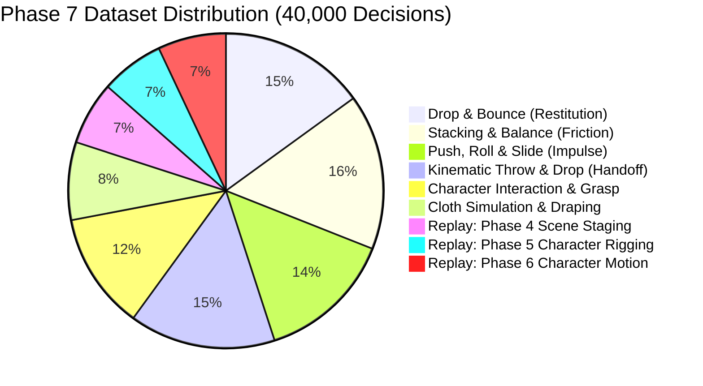

# BLENDER-S1 PHASE 7 — ARCHITECTURE & IMPLEMENTATION PLAN: RIGID BODY DYNAMICS, CLOTH SIMULATION & PHYSICAL INTERACTION

**Document Version:** 1.0.0  
**Status:** Architecture Specification & Implementation Plan  
**Target Architecture:** Blender-S1 v5 Physics Intelligence (`BlenderS1V5`)  
**Frozen Baseline:** `blender_s1_v4_2_motion_intelligence.pt` (SHA-256: `1fd7fe...`, 1,606,064 params)  
**Host Workspace:** `D:\New folder`  
**Execution Kernel:** Blender 5.2.3 LTS (Bullet Physics Engine + Cloth Simulator + Depsgraph Cartesian Truth)

---

## 1. Executive Summary & Architectural Principles

Phase 7 expands the Blender-S1 action model from purely kinematic motion into **full physical interaction, rigid body dynamics, and cloth simulation**. The system empowers the AI agent to reason about mass, momentum, restitution, friction, aerodynamic draping, and physical handoffs between animated character limbs and free-falling dynamic props.

### Architectural Principles
1. **Preserve Checkpoint Integrity:** The Phase 6.2 checkpoint (`blender_s1_v4_2_motion_intelligence.pt`, 1,606,064 params) remains frozen and unmodified as the pretrained weight foundation.
2. **Strict Action Monotonicity:** Existing action indices 0–35 (Phases 4, 5, 6) remain strictly byte- and index-identical. Twelve new physics actions are appended at indices 36–47.
3. **Decoupled Physics Integration:** Blender's native Bullet Physics engine and Cloth solver handle deterministic numerical integration ($F = ma$, symplectic Euler, constraint projection, collision manifolds). The learned model acts as the **strategic executive**—selecting actions, parameterizing physical attributes (mass, friction, restitution, spring stiffness), timing kinematic-to-dynamic releases, and executing recovery actions when simulations diverge.
4. **Typed Continuous Physics Parameterization:** Continuous physical attributes are mapped to dedicated normalized heads:
   - Mass: Log-scaled $\log_{10}(m \in [0.01, 100.0]\ \mathrm{kg})$
   - Friction & Restitution: Bounded sigmoid $[0.0, 1.0]$
   - Linear Impulse: Normalized 3D force vector $(\Delta p_x, \Delta p_y, \Delta p_z)$
   - Angular Torque: Continuous 6D SO(3) rotation representation
   - Cloth Stiffness: Bounded structural, shear, and bending multipliers

---

## 2. Action Schema & Vocabulary Extension

The action vocabulary expands from 36 to 48 actions. Indices 0–35 are preserved exactly as defined and verified in Phases 4, 5, and 6.

```
+----------------------------------------------------------------------------------------------------+
| BLENDER-S1 EXTENDED ACTION VOCABULARY (48 ACTIONS)                                                |
+-------+-------------------------------+---------+--------------------------------------------------+
| Index | Action Name                   | Phase   | Semantic Description                             |
+-------+-------------------------------+---------+--------------------------------------------------+
| 0-11  | Phase 4 Scene Actions         | Phase 4 | CREATE_OBJECT, SET_LOCATION, ..., FINISH_SUBTASK  |
| 12-23 | Phase 5 Character Rigging     | Phase 5 | CREATE_CHARACTER_PRIMITIVE, ..., SET_SHAPE_KEY   |
| 24-35 | Phase 6 Character Animation   | Phase 6 | SET_BONE_POSE, ..., COMPLETE_ANIMATION_SEQUENCE  |
| 36    | ADD_RIGID_BODY                | Phase 7 | Enable Bullet rigid body on target object        |
| 37    | CONFIGURE_RIGID_BODY          | Phase 7 | Parameterize mass, friction, restitution, shape  |
| 38    | APPLY_PHYSICAL_IMPULSE        | Phase 7 | Apply linear force (dp) or angular torque (tau)  |
| 39    | ATTACH_PHYSICS_CONSTRAINT     | Phase 7 | Bind two objects with HINGE, SLIDER, or SPRING   |
| 40    | SET_KINEMATIC_HANDOFF         | Phase 7 | Toggle dynamic vs animated for drop/throw        |
| 41    | TRIGGER_PHYSICS_BAKE          | Phase 7 | Step or bake physics simulation timeline         |
| 42    | ADD_COLLISION_DEFLECTOR       | Phase 7 | Configure passive deflector on floor/body mesh   |
| 43    | CREATE_CLOTH_SYSTEM           | Phase 7 | Add cloth modifier to mesh (cape, cloak, skirt)  |
| 44    | CONFIGURE_CLOTH_PROPERTIES    | Phase 7 | Parameterize structural stiffness, mass, damping |
| 45    | SETUP_CLOTH_COLLISION         | Phase 7 | Enable object collision & self-collision margin  |
| 46    | RESOLVE_PHYSICS_EXPLOSION     | Phase 7 | Recovery action for tunneling / instability      |
| 47    | COMPLETE_PHYSICAL_TASK        | Phase 7 | Terminal success token for physical episode      |
+-------+-------------------------------+---------+--------------------------------------------------+
```

---

## 3. Neural Architecture Extensions (Blender-S1 v5)

The model preserves the $d_{\text{model}}=192$, 4-layer Transformer backbone, ensuring **100% warm-start weight reuse**:

| Subsystem | v4.2 Checkpoint Tensors | v5 Architecture Tensors | Transfer Status |
| :--- | :---: | :---: | :--- |
| **Input Embeddings** | 9 tensors (task, cand, bone, global, type) | 9 tensors | `cand_proj` and `global_proj` input dims expand to 32 (warm-start first 24 columns) |
| **Transformer Backbone** | 48 tensors (4 layers) | 48 tensors | **100% Direct Copy (1,363,968 parameters)** |
| **Action Head** | 6 tensors (`[36, 192]`) | 6 tensors (`[48, 192]`) | First 36 action weights preserved; 12 new physics action weights initialized |
| **Pointer Networks** | 8 tensors (obj & bone queries) | 8 tensors | **100% Direct Copy (74,880 parameters)** |
| **Trans / Rot / Frame Heads** | 20 tensors | 20 tensors | **100% Direct Copy (75,770 parameters)** |
| **Physics Head** | 4 tensors (`scalar_head`, `[2, 64]`) | 4 tensors (`physics_head`, `[4, 128]`) | Transferred and widened to 4 typed physics outputs |
| **Total Model Parameters** | **1,606,064 parameters** | **~1,652,000 parameters** | **>97% parameter reuse from v4.2** |

---

## 4. Training Dataset Plan: 40,000 Physical Decisions



| Domain ID | Physical Domain | Decisions | Episodes | Steps/Ep | Ground Truth Physical Criteria |
| :---: | :--- | :---: | :---: | :---: | :--- |
| **D1** | **Drop & Bounce** | 6,000 | 600 | 10 | Restitution error $|e_{\text{measured}} - e_{\text{target}}| \le 0.05$; no floor penetration |
| **D2** | **Stacking & Balance** | 6,400 | 640 | 10 | 3-tier and 4-tier stack stability; drift $< 10\ \mathrm{mm}$; tilt $< 3^\circ$ at rest |
| **D3** | **Push & Slide** | 5,600 | 560 | 10 | Stopping distance $d = \frac{v_0^2}{2 \mu g} \pm 8\%$; correct friction calibration |
| **D4** | **Throw & Catch** | 6,000 | 500 | 12 | Parabolic trajectory apex $h = \frac{v_{0z}^2}{2g}$; kinematic release handoff |
| **D5** | **Character Contact** | 4,800 | 400 | 12 | Arm swing prop collision; impulse transfer to prop; character IK stability |
| **D6** | **Cloth Draping** | 3,200 | 400 | 8 | Cape / skirt pin attachment; zero mesh tunneling; realistic drape fold energy |
| **R1** | **Replay: Scene** | 2,600 | 260 | 10 | Phase 4 scene construction and staging retention |
| **R2** | **Replay: Rigging**| 2,600 | 220 | 12 | Phase 5 character mesh skinning and IK retention |
| **R3** | **Replay: Motion** | 2,800 | 220 | 13 | Phase 6 walk, run, jump, and pickup retention |
| **Total**| **All Domains** | **40,000** | **3,800** | **10.5** | **75% Train / 15% Val / 10% Test (Episode-Isolated)** |

---

## 5. Physical Acceptance Criteria

1. **Restitution Conservation:** $|e_{\text{measured}} - e_{\text{target}}| \le 0.05$ across dropped elastic spheres.
2. **Friction Stopping Distance:** $d_{\text{slide}} = \frac{v_0^2}{2 \mu g} \pm 8.0\%$.
3. **Equilibrium Stack Stability:** Center of mass horizontal drift $\Delta x_{\text{COM}} \le 12.0\ \mathrm{mm}$ after $t=3.0\ \mathrm{s}$ of simulation.
4. **Cloth Non-Penetration Depth:** Minimum distance between cloth vertices and deflector mesh $d_{\text{cloth-mesh}} \ge 1.0\ \mathrm{mm}$ (zero mesh tunneling).
5. **Throwing Kinematic-to-Dynamic Handoff:** Linear velocity continuity $\|v_{\text{prop}}(f_{\text{release}}^+) - v_{\text{hand}}(f_{\text{release}}^-)\| \le 0.15\ \mathrm{m/s}$.

---

## 6. Milestone Roadmap & Execution Order

- **Milestone 1:** Physics Engine Wiring & Action Schema (Actions 36–47, state observer extensions).
- **Milestone 2:** Procedural Physics Experts & Physical Solvers (D1–D6 procedural expert generation policies).
- **Milestone 3:** Pilot Dataset (2,500 decisions) & `BlenderS1V5` warm-start weight transfer verification.
- **Milestone 4:** Full Dataset Generation (40,000 decisions) & CPU Training across 4 epochs.
- **Milestone 5:** 100-Task Closed-Loop Physics Benchmark & Render Previews.

---

> [!IMPORTANT]
> **Approval Gate:** Large-scale training will not begin until this architecture specification, action schema, and validation strategy are reviewed and approved.

