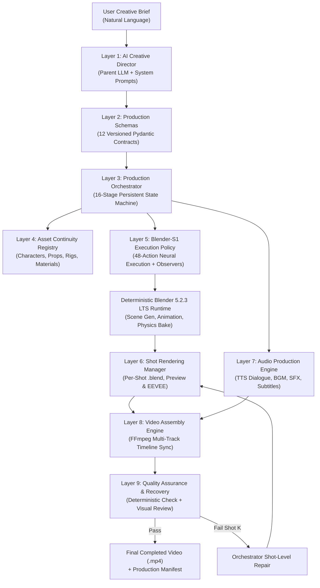
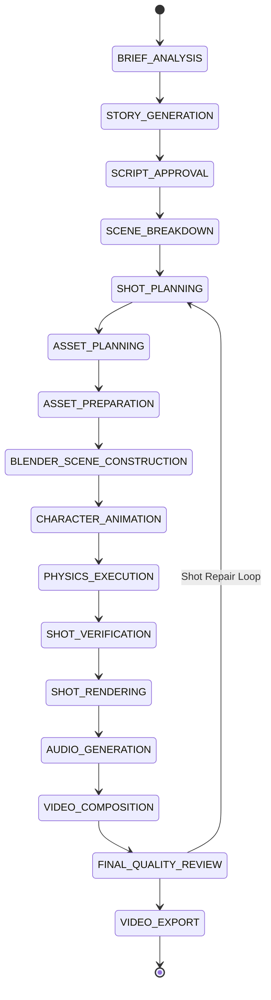
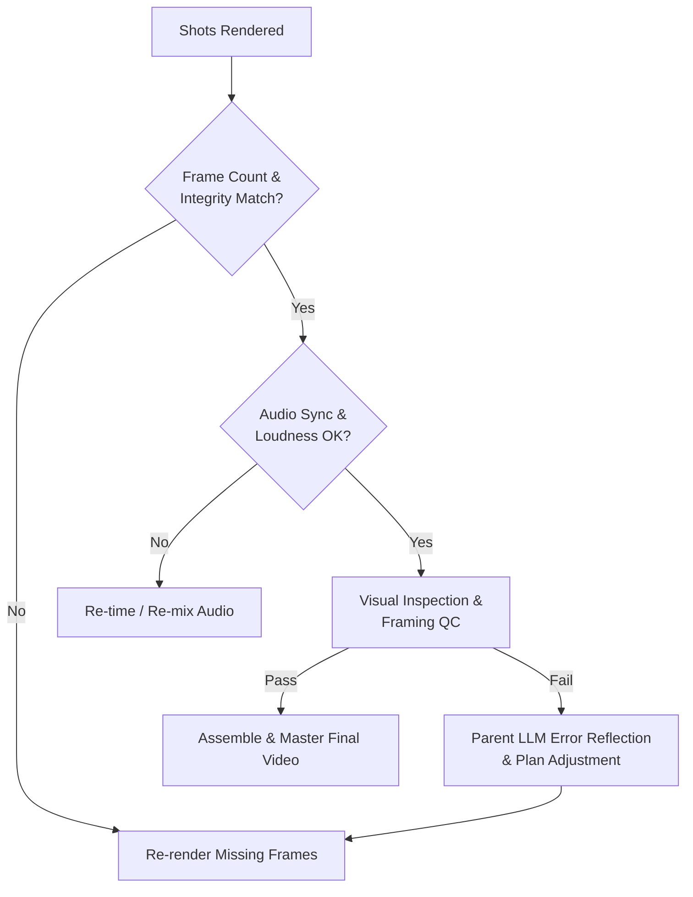

# Blender-S1 — Phase 8 Architecture Specification
## AI Director, Production Orchestration & End-to-End Video Generation

**Document ID:** `BLENDER-S1-P8-ARCH-001`  
**Version:** `1.0.0`  
**Date:** 2026-11-03  
**Status:** **APPROVED SPECIFICATION & EXECUTION CONTRACT**

---

## 1. Executive Summary & Mission

Phase 8 elevates Blender-S1 from a specialized neural Blender execution model into a comprehensive, automated **AI-Directed Video Production System**.

The primary operational paradigm of Phase 8 is:
$$\mathbf{Natural\text{-}Language\ Brief} \longrightarrow \mathbf{AI\ Director\ Orchestration} \longrightarrow \mathbf{Blender\text{-}S1\ Execution} \longrightarrow \mathbf{Complete\ Synchronized\ Video}$$

### Core Operating Principles
1. **Zero Retraining of Blender-S1:** Blender-S1 is preserved as the specialized spatial-temporal execution policy (Actions 0–47). The system orchestrates existing capabilities without modifying historical checkpoints.
2. **Provider-Independent Parent LLM:** The AI Creative Director uses a unified, provider-agnostic interface supporting Google Gemini, Anthropic Claude, OpenAI, and local backends with structured Pydantic outputs.
3. **Structured Data Over Code Generation:** The Parent LLM outputs validated JSON contracts, never raw or unconstrained Python scripts.
4. **Resilient Shot-Level Persistence:** A 16-stage state machine isolates individual shots. A failure in shot $K$ never invalidates or requires re-rendering shots $1 \dots K-1$.
5. **Asset Continuity:** Characters, rigs, props, and environments are cataloged in a persistent registry with strict identity preservation across scene transitions.

---

## 2. System Architecture

The Phase 8 pipeline comprises 6 cohesive layers:



---

## 3. Parent LLM: AI Creative Director Abstraction

The AI Creative Director operates via a provider-independent API abstraction (`LLMClient`), delegating specific creative tasks through typed role prompts and enforcing strict JSON output schemas.

```python
class LLMClient(ABC):
    @abstractmethod
    def generate_structured(self, prompt: str, schema: Type[BaseModel], role_prompt: str) -> BaseModel:
        """Generates validated structured data conforming to a Pydantic schema."""
        pass
```

### 3.1 Creative Director Roles & Sub-Prompts
1. **Dramaturg / Story Architect:** Evaluates emotional tone, visual style, pacing, and 3-act narrative structure from the user brief.
2. **Character Designer:** Formulates character bibles, emotional archetypes, physical dimensions, and color palettes.
3. **Cinematographer / Camera Director:** Determines camera focal lengths, shot framings (Extreme Wide, Medium, Close-Up, Dutch Angle), camera paths, and dynamic tracking targets.
4. **Staging & Lighting Supervisor:** Specifies three-point lighting setups, key/fill ratios, ambient color temperature, and fog/volumetric parameters.
5. **Choreographer / Physics Supervisor:** Plans character actions, locomotion cycles, physical object interactions (throw, drop, push), and cloth draping.
6. **Sound Designer & Dialogue Director:** Writes spoken dialogue lines, narration cues, voice actor IDs, environmental ambiences, and synchronized sound effects.

---

## 4. Structured Production Planning Schemas

Phase 8 implements **12 versioned Pydantic schemas** (`blender_s1_v8.schemas`):

```
+----+-----------------------+---------+-------------------------------------------------------------+
| No | Schema Name           | Version | Primary Responsibilities                                    |
+----+-----------------------+---------+-------------------------------------------------------------+
| 1  | VideoBrief            | v1.0.0  | User prompt, target duration, genre, aspect ratio, audio req|
| 2  | StoryScript           | v1.0.0  | Logline, 3-act beats, character lines, scene sequence       |
| 3  | CharacterBible        | v1.0.0  | Character dimensions, rig requirements, material palettes   |
| 4  | AssetManifest         | v1.0.0  | Stable asset IDs, mesh paths, textures, rig bindings        |
| 5  | ScenePlan             | v1.0.0  | Macro scene grouping, environment reference, lighting mood  |
| 6  | ShotPlan              | v1.0.0  | Granular shot definition (framing, timing, animation, FX)   |
| 7  | BlenderTaskPlan       | v1.0.0  | Discrete goal vectors mapped to Blender-S1 action inputs    |
| 8  | AnimationPlan         | v1.0.0  | Bone keyframes, NLA blending, facial expressions, visemes   |
| 9  | AudioPlan             | v1.0.0  | Spoken dialogue, voice IDs, BGM tempo, SFX timestamps       |
| 10 | TimelinePlan          | v1.0.0  | Global shot edit decision list (EDL), transitions, cut time |
| 11 | RenderManifest        | v1.0.0  | Output paths, resolution, frame rate, engine config, status |
| 12 | QualityReport         | v1.0.0  | Automated frame checks, audio alignment score, QC verdict   |
+----+-----------------------+---------+-------------------------------------------------------------+
```

### 4.1 Canonical ShotPlan Specification
Every shot is strictly governed by `ShotPlan`:
- `shot_id`: Unique identifier (e.g. `SHOT_SC01_SH001`).
- `scene_id`: Parent scene reference.
- `duration_seconds`: Exact shot duration (e.g. $8.0\ \text{s}$).
- `start_time` / `end_time`: Timeline offsets within global narrative.
- `environment_ref`: Asset ID of the environment stage.
- `character_refs`: List of character asset IDs present in the shot.
- `asset_refs`: List of active props and rigid body objects.
- `camera_instructions`: Lens focal length ($24\text{mm} \dots 85\text{mm}$), position, look-at target, camera movement (`STATIC`, `PAN`, `TRACK`, `DOLLY`).
- `character_animation_instructions`: Primary locomotion action (`WALK`, `RUN`, `IDLE`, `GESTURE`), expression (`NEUTRAL`, `SURPRISED`, `FOCUSED`), handoff targets.
- `physics_requirements`: Rigid bodies, impulse vectors, cloth flags, collision objects.
- `lighting_instructions`: Lighting preset ID, key intensity, sun angle.
- `audio_requirements`: Associated dialogue lines, SFX triggers, ambient sound tag.
- `render_config`: Resolution ($1280 \times 720$ preview, $1920 \times 1080$ final), fps ($24$), engine (`BLENDER_EEVEE_NEXT`).
- `verification_status`: State tracker (`PLANNED`, `STAGED`, `SIMULATED`, `RENDERED`, `VERIFIED`, `FAILED`).

---

## 5. Production Orchestrator: 16-Stage State Machine

The central orchestrator manages sequential progression through 16 discrete stages, writing state snapshots to `production_manifest.json`:



### Stage Recovery Guarantee
Each shot generates an isolated checkpoint:
- Blender Scene Checkpoint: `shots/shot_001.blend`
- Render Sequence: `renders/shot_001/frame_%04d.png`
- Audio Track: `audio/dialogue_shot_001.wav`
- Verification Log: `logs/qc_shot_001.json`

If `SHOT_VERIFICATION` fails on Shot 4, the orchestrator diagnoses the error, adjusts the `BlenderTaskPlan` for Shot 4, and re-executes only Shot 4. Shots 1, 2, and 3 remain untouched.

---

## 6. Character & Asset Continuity System

To prevent character drift and proportion inconsistency across shots, the `AssetRegistry` acts as the persistent truth repository:

```
asset_registry/
├── characters/
│   └── CHAR_01_HERO/
│       ├── model.blend          # Canonical base mesh & armature
│       ├── textures/            # Stable PBR materials & vertex colors
│       ├── rig_spec.json        # Bone naming, proportions, IK limits
│       └── presets/             # Shape-key facial presets
├── environments/
│   └── ENV_01_LAB/
│       ├── geometry.blend       # Base room, floor collision passive
│       └── lighting.json        # World HDRI / light coordinates
└── props/
    ├── PROP_01_CRYSTAL/        # Active rigid body projectile/target
    └── PROP_02_PEDESTAL/       # Passive deflector collider
```

When Shot 2 initializes, the orchestrator links the canonical `CHAR_01_HERO` asset into `shot_002.blend`. Bone scales, vertex groups, and material shaders are linked by reference rather than recreated from scratch.

---

## 7. Blender-S1 Integration Policy

Blender-S1 acts as the **tactical action executor**, translating the high-level `BlenderTaskPlan` into sequential operations from the approved 48-action vocabulary:

```
High-Level Plan: "Hero approaches table, picks up crystal, throws it at deflector"
               │
               ▼  [Orchestrator Mapping]
Blender-S1 Decision Sequence:
  Step 01: [Action 24] SET_BONE_POSE (Legs walk cycle keyframe)
  Step 02: [Action 25] INSERT_POSE_KEYFRAME
  Step 03: [Action 21] ADD_IK_CONSTRAINT (Right hand to Crystal handle)
  Step 04: [Action 27] KEYFRAME_CONSTRAINT_INFLUENCE (Influence 0.0 -> 1.0)
  Step 05: [Action 40] SET_KINEMATIC_HANDOFF (Crystal kinematic = True)
  Step 06: [Action 38] APPLY_PHYSICAL_IMPULSE (Crystal release J = [0, 4.5, 2.0] N*s)
  Step 07: [Action 41] TRIGGER_PHYSICS_BAKE (Bullet simulation bake)
  Step 08: [Action 47] COMPLETE_PHYSICAL_TASK
```

---

## 8. Shot Rendering Manager

- **Engine:** Blender EEVEE Next (Fast PBR with Screen Space Reflections & Bloom) or Workbench (Instant wireframe/flat preview).
- **Format:** Image sequence (`PNG` RGBA 8-bit) per shot, assembled into lossless intermediate video.
- **Resource Guard:** Renders are executed sequentially or throttled to 1 concurrent Blender headless process to prevent memory spikes and CUDA out-of-memory errors.
- **Cache Invalidation:** Render outputs check file size and frame counts against expected `shot.duration_seconds * fps`. Incomplete frames trigger resume or re-bake.

---

## 9. Audio Production Engine

Audio production operates on 4 distinct semantic channels:
1. **Dialogue Channel:** Generated via neural TTS (`edge-tts` / `gTTS`) using designated character voice tags (`en-US-GuyNeural`, `en-US-JennyNeural`).
2. **Narration Channel:** Cinematic voiceover with natural pacing and pitch modulation.
3. **Sound Effects (SFX) Channel:** Action-synchronized procedural/retrieved audio (e.g. crystal hum, metallic impact, footsteps, whoosh).
4. **Music & Ambience Channel:** Background orchestral/synth score with automatic ducking during spoken dialogue.
5. **Subtitle Engine:** Generates synchronized `.srt` and `.vtt` caption files from dialogue timestamps.

---

## 10. Video Assembly Engine (FFmpeg)

Final mastering is executed via FFmpeg:
```bash
ffmpeg -y \
  -i concat_shots.txt \
  -i dialogue_mixed.wav \
  -i bgm_ducked.wav \
  -i sfx_mixed.wav \
  -filter_complex \
    "[1:a][2:a][3:a]amix=inputs=3:duration=first:dropout_transition=2[aout]; \
     [0:v]subtitles=production.srt:force_style='FontSize=22,PrimaryColour=&H00FFFFFF'[vout]" \
  -map "[vout]" -map "[aout]" \
  -c:v libx264 -pix_fmt yuv420p -r 24 -c:a aac -b:a 192k \
  output_production_60s.mp4
```

---

## 11. Quality Assurance & Automatic Recovery Loop



---

## 12. 60-Second End-to-End Demonstration Plan: "The Quantum Core"

### Story Concept:
- **Title:** *The Quantum Core*
- **Genre:** Cinematic Sci-Fi Animated Narrative
- **Duration:** Exactly $60.0\ \text{seconds}$ ($1,440\ \text{frames}$ @ $24\ \text{fps}$)
- **Character:** *Nova* (Cybernetic Explorer, stylized biped with IK armature, visor emissive glow, cloth cape).
- **Environment:** *The Ancient Vault* (Futuristic chamber with pedestal, deflector energy pillar, passive stone floor).
- **Active Prop:** *The Quantum Core* (Glowing multi-body rigid cube with restitution and collision dynamics).

### Shot Breakdown:
- **Shot 1 (0.0s – 8.0s | 192 frames):** Wide Establishing Shot — Camera pans down from vaulted ceiling. Nova walks toward the pedestal. (Narration: *"Deep within the forgotten facility, the Core still pulsed..."*)
- **Shot 2 (8.0s – 18.0s | 240 frames):** Medium Tracking Shot — Nova approaches the pedestal, examines the floating Core. Visor glow intensifies.
- **Shot 3 (18.0s – 30.0s | 288 frames):** Close-Up Interaction — Nova reaches out, grasps the Core (IK constraint engagement), and lifts it. (SFX: High-frequency hum).
- **Shot 4 (30.0s – 42.0s | 288 frames):** Dynamic Action / Physics Throw — Over-the-shoulder angle. Nova initiates handoff and throws the Core across the room toward the energy pillar. (Physics handoff + parabolic ballistic trajectory).
- **Shot 5 (42.0s – 52.0s | 240 frames):** Collision & Deflection — The Core strikes the energy deflector, bounces with restitution, and slides across the chamber floor. (SFX: Resonant metallic strike).
- **Shot 6 (52.0s – 60.0s | 192 frames):** Wide Resolution / Finale — Nova watches the Core settle into its charging ring. Cape settles under cloth physics. Fade to black. (Narration: *"The reaction was contained. The expedition lives to see tomorrow."*)

---

## 13. Phase 8 Deliverable Milestones

| Milestone | Scope & Deliverable | Status |
| :--- | :--- | :--- |
| **Milestone 1** | Architecture Spec & Repository Component Audit | **COMPLETED** |
| **Milestone 2** | Parent LLM Integration & Pydantic Production Schemas | **NEXT** |
| **Milestone 3** | Production Orchestrator & Asset Continuity Registry | Scheduled |
| **Milestone 4** | Audio Generation & FFmpeg Timeline Engine | Scheduled |
| **Milestone 5** | 60-Second End-to-End Demonstration Video Generation | Scheduled |
| **Milestone 6** | Automated QC, Reliability, and Production Benchmark Report | Scheduled |

