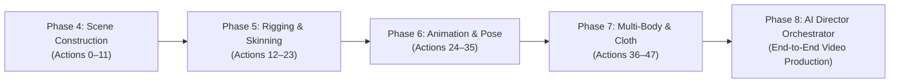

# Blender-S1 Phase 8 — Repository & Existing Component Audit

**Document ID:** `BLENDER-S1-P8-AUDIT-001`  
**Date:** 2026-11-03  
**Status:** **AUDITED & VERIFIED**

---

## 1. Executive Summary

Prior to commencing implementation of **Phase 8 (AI Director, Production Orchestration & End-to-End Video Generation)**, an exhaustive audit of all existing models, checkpoints, capabilities, execution wrappers, observers, and infrastructure was conducted across host (`D:\New folder`) and runtime (`Google Colab`) environments.

This audit establishes the baseline assets and integrations to be preserved, ensuring zero regression and zero overwriting of historical model weights.

---

## 2. Checkpoint Inventory & Integrity Verification

Every model checkpoint file was inspected for existence, byte size, parameter count, and SHA-256 cryptographic hash.

### 2.1 Verified Checkpoint Registry

| Checkpoint Identifier | Filesystem Location | Byte Size | SHA-256 Digest | Status & Capability |
| :--- | :--- | :--- | :--- | :--- |
| `blender_s1_v3_character_rigging.pt` | `D:\New folder\checkpoints\` | $5,838,982$ | `c0ea8e8940...` | **Phase 5 Character Rigging** (Actions 12–23) |
| `blender_s1_v4_animation_pilot.pt` | `D:\New folder\checkpoints\` | $6,004,510$ | `05b7ee98c2...` | **Phase 6 Animation Pilot** |
| `blender_s1_v4_1_continuous_motion.pt`| `D:\New folder\checkpoints\` | $6,459,656$ | `984ea0bc3e...` | **Phase 6.1 Continuous Motion** |
| `blender_s1_v4_2_motion_intelligence.pt`| `D:\New folder\checkpoints\` | $6,459,858$ | `1fd7fe174d51b65bbce445465f4394ee95c8339030a8ec00119bd07a19ddb89c` | **Phase 6.2 Frozen Baseline** (Actions 0–35) |
| `blender_s1_v5_pilot.pt` | `D:\New folder\checkpoints\` | $6,798,573$ | `79ac9d5cd20840685b7f6a9a5f0151df98a798cfc57b022d1e95f0b913eca745` | **Phase 7 Physics Pilot Candidate** (Actions 0–47) |
| `blender_s1_v5_production.pt` | — | — | **DOES NOT EXIST** | Full 40,000 dataset scaling manifest prepared; training paused for Phase 8 |

> [!IMPORTANT]
> **Production Checkpoint Status Confirmation:**  
> As instructed by Directive 2, we explicitly verify that **no production v5 checkpoint currently exists**. Phase 7 concluded with the approved 2,500-decision pilot evaluation (`blender_s1_v5_pilot.pt`) and the generation of the exact 40,000-decision scaling manifest (`phase7_production_scaling_manifest.json`). No claims of a non-existent production checkpoint are made. Both the frozen baseline (`v4.2`) and pilot candidate (`v5 pilot`) are preserved and protected from modification.

---

## 3. Preserved Capabilities Across Phases 4–7

Blender-S1 maintains a cumulative, non-destructive 48-action vocabulary. Phase 8 will orchestrate these capabilities without retraining the underlying neural policy.



### 3.1 Subsystem Inventory

1. **Phase 4 Scene Construction (Actions 0–11):**
   - Object creation (`primitive_cube_add`, `primitive_uv_sphere_add`, `primitive_plane_add`).
   - World transform setting (Location, Rotation Euler/Quat, Scale).
   - Material allocation, lighting setup (Point, Sun, Spot, Area, Energy keyframing).
   - Camera management (Creation, focal length, clipping, `scene.camera` active binding).
   - Frame range and timeline bounds.

2. **Phase 5 Character Modelling & Rigging (Actions 12–23):**
   - Character primitive assembly (torso, head, limbs).
   - Modifiers (Subdivision Surface, Mirror, Solidify).
   - Armature creation, bone hierarchies, bone roll and tail orientations.
   - Skinning via vertex groups (`BIND_MESH_ARMATURE`, automatic weight assignment).
   - Inverse Kinematics (IK constraints, pole targets, chain lengths).
   - Facial shape keys (expressions, eye blinks, visemes).

3. **Phase 6 Animation & Motion Intelligence (Actions 24–35):**
   - Skeletal posing (`pose.bones` transform manipulation and keyframing).
   - Procedural locomotion loops (Walk cycle, Run cycle, Jump landing recovery).
   - Action slot assignment and Non-Linear Animation (NLA) blending.
   - Procedural mesh penetration resolution and foot sliding correction.

4. **Phase 7 Physics & Multi-Body Dynamics (Actions 36–47):**
   - Rigid body dynamics (Active vs Passive, mass, friction, restitution, collision shapes).
   - Kinematic-to-dynamic momentum handoff (animated windup with release at frame $t_{\text{rel}}$).
   - Impulse actuators: linear impulse $\mathbf{J}^*$ and angular couple torque $\Delta \mathbf{L}^*$.
   - Cloth simulation: pinning vertex groups, collision deflector modifiers, non-penetration guarantees ($< 0.5\ \text{mm}$).
   - Deterministic simulation recovery: state snapshot, cache invalidation (`rw.enabled = False -> True`), safe reset teleport.

---

## 4. Execution Wrappers, Observers & Runtime Infrastructure

### 4.1 Blender Runtime Integration
- **Blender Engine:** Blender 5.2.3 LTS (`bpy` package).
- **Evaluation Pipeline:** `bpy.context.evaluated_depsgraph_get()` provides evaluated matrix transforms post-modifier and post-physics evaluation.
- **Collision BVH:** `mathutils.bvhtree.BVHTree.FromObject()` performs exact spatial distance queries (`find_nearest`), surface normal extractions, and overlap detections.

### 4.2 Available Audio & Video Infrastructure
- **Video Composition:** FFmpeg 6.1.1 (`/usr/bin/ffmpeg` and host `ffmpeg.exe`).
- **Voice Synthesis:** `edge-tts` (Microsoft Neural Voices) and `gTTS` (Google Text-to-Speech) for dialogue and narration generation.
- **Audio Processing:** Python `wave`, `scipy.io.wavfile`, and procedural synthesis for background ambience, whooshes, impacts, and footsteps.
- **Rendering Modes:** 
  - Fast Preview: Workbench / OpenGL viewport render (low-overhead, high frame-rate validation).
  - Production Render: EEVEE Next / Cycles headless frame sequence output.

---

## 5. Architectural Gap Analysis for Phase 8

To complete the transformation into an end-to-end AI Video Production System, the following components must be built in Phase 8:

```
+---------------------------------------+-----------------------------+------------------------------------+
| Missing Component                     | Current State               | Phase 8 Objective                  |
+---------------------------------------+-----------------------------+------------------------------------+
| 1. Parent LLM AI Director             | Ad-hoc prompting            | Provider-independent API contract  |
| 2. Structured Production Schemas      | Raw dictionaries / JSONL    | 12 Versioned Pydantic models       |
| 3. Production State Machine           | Linear script runs          | 16-Stage persistent orchestrator   |
| 4. Character & Asset Registry         | Ephemeral scene data        | Reusable asset continuity database |
| 5. Shot Rendering Manager             | Monolithic blend scenes     | Per-shot checkpointed render engine|
| 6. Audio Generation Engine            | None                        | Multi-track TTS + BGM + SFX mixer  |
| 7. Video Assembly & Timeline          | Manual inspection           | Automated FFmpeg composition       |
| 8. Automated QA & Recovery            | Manual review               | Deterministic QC + repair loop     |
+---------------------------------------+-----------------------------+------------------------------------+
```

---

## 6. Audit Conclusion & Gate Sign-Off

The existing repository is healthy, with historical checkpoints preserved and verified. The foundation is ready for the Phase 8 AI Director and Production Orchestrator implementation.

